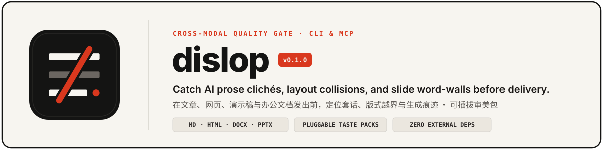

<p align="center">
  
</p>

<p align="center">
  <strong>English</strong> · <a href="./README.zh-CN.md">简体中文</a> · <a href="./docs/architecture.md">Architecture</a> · <a href="./CONTRIBUTING.md">Contributing</a> · <a href="https://dislop.com">dislop.com</a>
</p>

---

**`dislop`** is an open-source, cross-modal quality gate that inspects prose, web interfaces, slide decks, and office documents before delivery. Instead of feeding drafts into an opaque "AI humanizer" that introduces grammar errors or alters facts, `dislop` runs deterministic probes first, pairs every flagged pattern with concrete before/after editorial exemplars, and keeps domain taste modular through pluggable **Taste Packs**.

## Why `dislop` Exists

First-generation "anti-AI" rewriters fail in real production work for three reasons:

1. **Blind full-text rewriting degrades facts**: Unconstrained LLM rewrites frequently mutate numbers, units, proper nouns, and citations to dodge statistical detectors.
2. **Text-only tools miss visual and structural tells**: A deck with 260 words crammed onto Slide 4, a landing page wrapped in default indigo-purple-pink gradients, or a PDF leaking local filesystem paths fails reader trust before anyone reads paragraph two.
3. **Good taste is domain-specific, not universal**: What makes a client research brief crisp is different from what gives a 6,000-word literary essay breathing room.

`dislop` separates **deterministic inspection (`src/dislop/`, `bin/`)** from **curated editorial standards (`packs/`)**, exposing both a fast local CLI and a stdio **Model Context Protocol (MCP)** server for coding and writing agents.

## Quick Start

### Node.js / `npx` (Zero External Dependencies)

```bash
# Audit a Markdown file, HTML page, or entire repository
node ./bin/dislop.mjs check README.md
node ./bin/dislop.mjs check ./docs --pack business-brief

# List installed Taste Packs or inspect a rule's editorial rationale
node ./bin/dislop.mjs packs
node ./bin/dislop.mjs explain zh-cliche-connector
```

### Python / `uv` (Includes Zero-Dependency `.docx` & `.pptx` Inspection)

```bash
# Run directly from source or install into a virtual environment
PYTHONPATH=src python3 -m dislop.cli check ./README.md
PYTHONPATH=src python3 -m dislop.cli check ./proposal.pptx --pack deck-and-ui
```

### Connect as an MCP Server (Claude Code, Codex, Cursor, Antigravity)

Add `dislop` to your MCP client configuration so your agent checks drafts and pulls editorial exemplars before handing files back to you:

```json
{
  "mcpServers": {
    "dislop": {
      "command": "node",
      "args": ["/path/to/dislop/bin/dislop-mcp.mjs"]
    }
  }
}
```

Exposed MCP tools:
- `dislop_check`: Audit raw text, a single file (`.md`, `.html`, `.svg`, `.docx`, `.pptx`), or a directory against a Taste Pack.
- `dislop_packs`: List installed Taste Packs, supported modalities, and rule counts.
- `dislop_exemplars`: Retrieve annotated `bad -> good` rewrites and editorial rationales so the calling agent can revise flagged passages without corrupting surrounding facts.

## Built-in Taste Packs

| Pack ID | Target Modality | What It Catches |
| :--- | :--- | :--- |
| `business-brief` | Proposals, memos, research reports (`.md`, `.docx`, `.pdf`) | Filler transitions, inflated verbs, local path leaks, excessive em-dash cadence |
| `literary-essay` | Long-form essays, columns, non-fiction (`.md`, `.html`) | Moralizing paragraph endings, forced triadic symmetry, translationese passive scaffolds |
| `deck-and-ui` | Slide decks & web UI (`.pptx`, `.html`, `.svg`, `.css`) | Per-slide word walls (`>120` words / `>280` CJK chars), default purple-pink gradients, emoji confetti, unfinished placeholders |

## Dogfooding Standard

Every Markdown document, SVG asset, and release note in this repository is checked by `dislop` itself in CI (`.github/workflows/ci.yml`). Pull requests that trigger slop findings in repository docs fail the build until rewritten cleanly.

## Repository Layout

```text
dislop/
├── assets/                # Brand mark (logo.svg) and masthead banner (banner.svg)
├── bin/                   # Zero-dependency Node.js CLI & stdio MCP server
├── src/dislop/            # Zero-dependency Python CLI, OOXML (.docx/.pptx) inspector & MCP server
├── packs/                 # Pluggable Taste Packs (rules + before/after exemplars)
├── docs/                  # English & Chinese architecture specifications
└── tests/                 # Unit, OOXML fixture, and self-dogfooding test suite
```

## License

Licensed under the [Apache License 2.0](./LICENSE).
