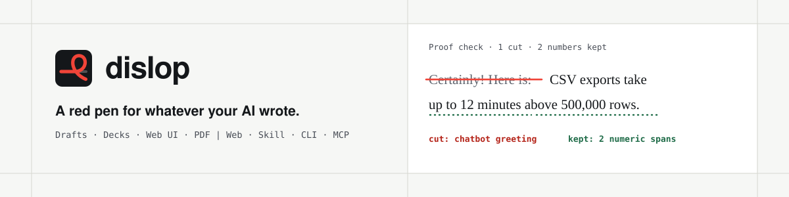

<p align="center">
  <picture>
    <source media="(prefers-color-scheme: dark)" srcset="./assets/banner-dark.svg">
    
  </picture>
</p>

<p align="center">
  <a href="./README.md">English</a> ·
  <a href="https://dislop.com">官网与清样工作台 (dislop.com)</a> ·
  <a href="./docs/architecture.zh-CN.md">架构说明</a> ·
  <a href="./docs/design-system.zh-CN.md">设计规范</a> ·
  <a href="./LICENSE">Apache-2.0</a>
</p>

`dislop` 是发稿前使用的交付物检查与改稿复检工具。它读取 Markdown、纯文本、HTML、CSS、JSX/TSX、SVG、Word（`.docx`）、PowerPoint（`.pptx`）与 PDF 结构元数据，标出命中规则的文件、行号、段落序号或幻灯片页码。

`dislop` 不会在后台偷偷改写你的正文。作者或本地 Agent 修改命中片段后，运行 `dislop verify` 可逐项比对改前与改后文本，确认数字、限定词（如 `最多`、`至少`、`up to`）、单位、链接、代码片段与引用编号全部原样保留，并拦截把一阶公关词换成二阶口号句（如 `不是 A，而是 B` 或三连短句）的过矫改写。

## 为什么要做两层分治

市面上主打“去 AI 味 / 拟人化改写”的工具为了绕过概率检测器，经常顺手删改数字或限定条件；而单纯维护一张禁用词黑名单，既会误伤正常专名（如调试器 `Delve`、`抓手机拍照`、`北京大学、清华大学、复旦大学`），又会逼着大模型换用故作深沉的短句口号。

`dislop` 将检查规则拆为职责分明的两层：

1. **基础发布底线（`packs/core/`，固定 `error`，所有包默认继承）**：客观交付事故，默认阻断构建——包括本机路径泄露（`file:///Users/example/spec.pdf`）、未替换模板占位符（`[insert ...]`、`{{var}}`、`【待补充】`）、未删净的 AI 寒暄与内部引用标记（`好的，以下是修改后的…`、`[oaicite:...]`）、粘贴进 Word/PPT 未渲染的裸 Markdown 星号、空链接 `<a href="#">`、低于 WCAG AA（`< 4.5:1`）的前景背景对比度、深色模式 Z 轴亮度倒置，以及越出画布边界的 PPT 文本框。
2. **文体与界面审美包（`warning` / `info`，默认提示不破构建）**：按文体划分的可插拔 JSON 规则包（`business-brief`、`literary-essay`、`deck-and-ui`）。每条规则均附带**删除测试（Deletion Test）**、**反例 / 二阶陷阱 / 合规改写**三段对照，以及正反自动化测试样本。

## 支持格式与能力边界（`v0.2.0`）

Node.js 版（`bin/dislop.mjs`）与 Python 版（`src/dislop/`）均保持**零第三方运行时依赖**，并通过同一套跨语言一致性测试（`tests/test_conformance.py`）。

| 类别 | 扩展名 | 确定性检出范围 | 明确边界 |
|---|---|---|---|
| 文稿与长文 | `.md`, `.mdx`, `.txt` | 基础底线 + 铺垫式开场白、“不是 A，而是 B”对比套句、连续超短句口号、四字排比串、段尾说教升华、无出处权威归因、中文半角标点混排 | 代码块、行内代码、URL、引用块与 `dislop-quote` 示例区对审美规则自动屏蔽 |
| 前端与矢量图 | `.html`, `.css`, `.jsx`, `.tsx`, `.svg` | 空跳转链接、无说明的静态禁用按钮、单文件可解析对比度、深色模式表面明度阶梯、默认紫粉渐变与渐变裁切标题、胶囊标签泛滥、三层套盒、SVG 文字越界风险 | 仅做单文件静态分析；动态水合后的运行时 DOM 需配合浏览器测试 |
| Word 文档 | `.docx` | 合并同段落 `<w:t>` 文本运行、检出未接受修订（`<w:ins>`/`<w:del>`）与残留批注、损坏引用域、裸 Markdown 残留、外部 `file:` 链接及正文套话（定位至 `para N`） | 报出段落序号，不计算排版渲染页码 |
| 演示文稿 | `.pptx` | 按 `p:sldIdLst` 真实放映顺序定位页码、合并段落运行、单页字数墙（英文 > 120 词 / 中文 > 280 字）、项目符号超限（> 6 条）、`<a:normAutofit>` 自动缩排（< 80%）、文本框越界、空泛名词标题 | 隐藏幻灯片（`show="0"`）跳过密度检查并在报告中显式列为 `[SKIP]` |
| PDF 文档 | `.pdf` | `/URI` 本机文件链接、残留原始文件名 `/Title`（如 `Microsoft Word - ...`）、未嵌入字体描述符、跨页 `/MediaBox` 尺寸不一致 | 加密 PDF 与完整 CID 正文提取在零依赖模式下显式报告 `[SKIP]`，绝不静默伪装为“0 问题” |

## 快速开始

### Node.js 20+（零外部依赖）

```bash
# 检查当前目录（命中 core 错误时退出码为 1，同时打印审美包提示）
npx --yes github:dislop-ai/dislop check .

# 仅检查相对 main 分支新增/修改的行，输出 GitHub PR 行内注解
npx --yes github:dislop-ai/dislop check --changed origin/main --format github

# 查看某条规则的删除测试与正反改稿样本
npx --yes github:dislop-ai/dislop explain negation-pivot-frame --lang zh

# 核对改稿前后数字、限定词、链接与代码片段是否完整保留
npx --yes github:dislop-ai/dislop verify draft.before.md draft.after.md
```

### Python 3.10+（零外部依赖）

```bash
# 通过 uvx 直接从 Git 仓库运行
uvx --from git+https://github.com/dislop-ai/dislop dislop check quarterly-review.pptx

# 或克隆仓库本地运行
git clone https://github.com/dislop-ai/dislop.git
cd dislop
PYTHONPATH=src python3 -m dislop.cli check . --fail-on warning --lang zh
```

## 接入 MCP（`Claude Code`、`Codex`、`Cursor`、`Windsurf`）

将 `dislop` 注册为本地 stdio MCP 服务，让写作或研发 Agent 在交稿前自动执行“检查 -> 局部修订 -> `verify` 复检”：

```json
{
  "mcpServers": {
    "dislop": {
      "command": "npx",
      "args": ["--yes", "github:dislop-ai/dislop", "--mcp"]
    }
  }
}
```

提供的 4 个 MCP 工具：

- `dislop_check` — 检查内存文本 `text` 或工作区相对路径 `path`，返回命中区间、`protectedFacts` 受保护事实清单、删除测试与改稿示例（不向模型倾倒原始禁用词表，防止触发同义词硬换）。
- `dislop_verify` — 对照 `before` 与 `after`，一旦丢失数字/限定词、改动链接/代码，或滑向二阶口号句式即返回 `rejected` 与具体原因。
- `dislop_explain` — 按 `ruleId` 查询规则依据与三段改稿对照。
- `dislop_packs` — 列出当前安装的规则包（`core`、`business-brief`、`literary-essay`、`deck-and-ui`）。

## 项目配置与单行豁免

运行 `dislop init` 生成 `.dislop.json`（本地私有禁止词可放入被 Git 忽略的 `.dislop.local.json`）：

```json
{
  "failOn": "error",
  "ignore": ["vendor/**", "dist/**"],
  "overrides": [
    { "files": ["docs/**/*.md"], "pack": "business-brief" },
    { "files": ["essays/**/*.md"], "pack": "literary-essay" },
    { "files": ["site/**/*.{html,css,svg}"], "pack": "deck-and-ui" }
  ],
  "allow": ["Delve", "无缝钢管"]
}
```

确需在特定行保留原文引用时，须附带豁免理由（`--report-unused` 会检出失效的冗余豁免）：

```markdown
<!-- dislop-ignore-next-line zh-bureaucratic-padding -- 原样摘录外部招标文件条款 -->
```

## 自举自审（Dogfooding）

本仓库在 GitHub Actions CI 中执行 `dislop pack-test`（Node 与 Python 双端各 101 项样本断言）、跨语言一致性测试（`tests/test_conformance.py`），并对仓库自身的 Markdown 文档、SVG 品牌资产与 `site/` 官网执行 `dislop check . --fail-on warning`（`packs/` 与 `tests/` 因存放反例样本默认排除）。

## 官方网站

- 官网与交互式清样工作台：[https://dislop.com](https://dislop.com)（静态 Nginx 托管，零后端进程，响应头与页面级 CSP 双重锁定 `connect-src 'none'`）

## 开源许可

[Apache License 2.0](./LICENSE)
