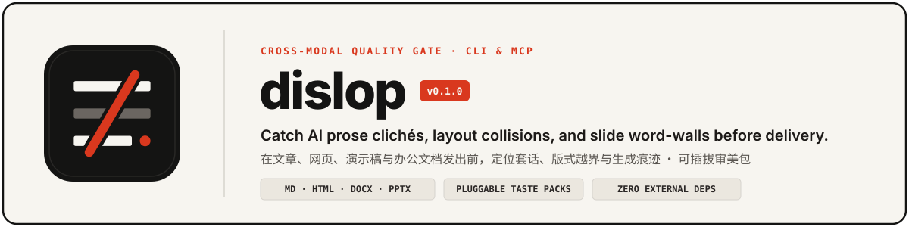

<p align="center">
  
</p>

<p align="center">
  <a href="./README.md">English</a> · <strong>简体中文</strong> · <a href="./docs/architecture.zh-CN.md">架构设计</a> · <a href="./CONTRIBUTING.md">参与贡献</a> · <a href="https://dislop.com">dislop.com</a>
</p>

---

**`dislop`** 是一个开源的跨模态交付质检门禁，用于在文章、网页、图文卡片与办公文档（`DOCX` / `PPTX` / `Markdown` / `HTML`）正式发出前，定位套话修辞、版式越界与常见生成痕迹。

与市面上直接让大模型通篇改写的“去 AI 味（Humanizer）”工具不同，`dislop` 坚持**确定性探针先行、正反改稿样本对照、引擎与审美包解耦**——先精准指出哪一行、哪一页出了什么问题，再给出同体裁的人工改稿先例，绝不为了绕过统计检测器而篡改事实数字或把专业文本改得口水化。

## 解决什么真问题

1. **盲目通篇重写会污染事实**：黑盒改写工具极易把金额、百分比、专有名词与引用出处改错，专业交付场景根本不敢直接用。
2. **纯文本检查看不见版式灾难**：第 4 页塞满 300 字的 PPT 字墙、千篇一律的蓝紫粉渐变落地页、残留本机绝对路径的文档，读者扫一眼就会失去信任。
3. **好品味因文体而异**：商业研究简报追求结论前置与数字有据，长篇非虚构随笔看重叙事留白与个人语感。把不同领域的编辑经验封装成可插拔的 **Taste Packs（审美包）**，才能让真正懂文字、懂设计的人把经验沉淀下来复用。

## 快速上手

### Node.js 命令行（零第三方运行时依赖）

```bash
# 检查单篇文档或整个目录
node ./bin/dislop.mjs check README.zh-CN.md
node ./bin/dislop.mjs check ./docs --pack business-brief

# 查看内置审美包与单条规则的改稿理由
node ./bin/dislop.mjs packs
node ./bin/dislop.mjs explain zh-cliche-connector
```

### Python 命令行（原生支持零依赖 `.docx` 与 `.pptx` 逐页密度检查）

```bash
# 直接从源码运行，无需安装第三方解析库即可检查 Word 与 PPTX
PYTHONPATH=src python3 -m dislop.cli check ./README.zh-CN.md
PYTHONPATH=src python3 -m dislop.cli check ./deck.pptx --pack deck-and-ui
```

### 接入本地 Agent（MCP Server）

在 Claude Code、Codex、Cursor 或 Antigravity 的 MCP 配置中加入 `dislop`，让 Agent 在向你交付文稿或前端页面前先跑一轮确定性自检：

```json
{
  "mcpServers": {
    "dislop": {
      "command": "node",
      "args": ["/path/to/dislop/bin/dislop-mcp.mjs"]
    }
  }
}
```

提供的 MCP 工具：
- `dislop_check`：按指定审美包检查文本、单个文件（`.md` / `.html` / `.svg` / `.docx` / `.pptx`）或整个目录，返回精确行号与页码。
- `dislop_packs`：列出当前可用的审美包、适用模态与规则数。
- `dislop_exemplars`：拉取对应审美包的 `bad -> good` 改稿对照与编辑理由，供主控 Agent 只针对问题句段做最小修订。

## 内置审美包（Taste Packs）

| 审美包 ID | 适用媒介 | 重点拦截问题 |
| :--- | :--- | :--- |
| `business-brief` | 商业策划书、研究简报、对客方案（`.md`, `.docx`） | 中英文空洞连接词、拔高大词、本机路径残留、破折号堆砌 |
| `literary-essay` | 长篇公众号、非虚构特稿、随笔（`.md`, `.html`） | 段末强行升华点题、对称排比陈词、生硬翻译腔被动句 |
| `deck-and-ui` | 演示文稿、网页与信息卡片（`.pptx`, `.html`, `.svg`, `.css`） | 单页 PPT 字墙（`>120` 英文词或 `>280` 汉字）、默认紫粉渐变套路、表情包堆砌、未替换占位符 |

## 吃自己的狗粮（Self-Dogfooding）

本仓库自身的中英文文档、架构说明与 SVG 视觉资产在每次 Git 提交和 GitHub Actions CI（`.github/workflows/ci.yml`）中都会经过 `dislop check` 自检，命中任何一条套话或卫生规则即阻断构建。

## 开源许可

基于 [Apache License 2.0](./LICENSE) 许可开源。
