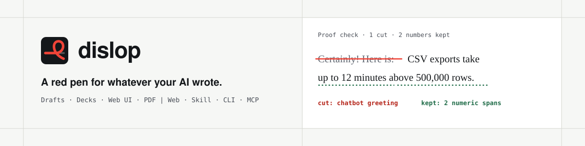

<p align="center">
  <picture>
    <source media="(prefers-color-scheme: dark)" srcset="../assets/banner-dark.svg">
    
  </picture>
</p>

<p align="center">
  <a href="https://dislop.com/awesome/">Interactive Filter (dislop.com/awesome/)</a> ·
  <a href="https://dislop.com/#workbench">Try Offline Workbench</a> ·
  <a href="https://dislop.com/awesome/index.json">Agent JSON</a> ·
  <a href="https://dislop.com/awesome/index.md">Raw Markdown</a> ·
  <a href="../README.md">Main Repo (dislop)</a> ·
  <a href="../README.zh-CN.md">简体中文</a>
</p>

# Awesome Anti-Slop

**87 verified tools, linters, writing guides, UI/design rules, code/PR policies, and research papers for removing AI slop — across English and Chinese.**

Star [`dislop-ai/dislop`](https://github.com/dislop-ai/dislop) to bookmark this list, follow new entries, and keep the bundled zero-dependency linter (`npx`, `uvx`, `SKILL.md`, `MCP`, and offline browser workbench) one click away.

- **Verified snapshot**: Every URL, GitHub star count, and push date was checked on `2026-11-21` (19 deterministic checkers · 21 Chinese or multilingual entries).
- **Human + Agent dual-native**: Read here on GitHub, filter offline at [https://dislop.com/awesome/](https://dislop.com/awesome/), or point any agent at [`/awesome/index.json`](https://dislop.com/awesome/index.json) or [`/awesome/index.md`](https://dislop.com/awesome/index.md).
- **Single source of truth**: Compiled automatically from [docs/research/anti-slop-radar-index.json](../docs/research/anti-slop-radar-index.json) (`dislop.radar/2`).

## Contents

- [Standards, Research, and Policy](#standards-research-and-policy) (13) — 标准、研究与平台政策
- [English and Multilingual Writing](#english-and-multilingual-writing) (14) — 英文与多语种写作
- [Chinese Writing and Localization](#chinese-writing-and-localization) (9) — 中文写作与去翻译腔
- [Deterministic Linters](#deterministic-linters) (9) — 确定性检查工具
- [UI, Design, and Diagrams](#ui-design-and-diagrams) (12) — 前端 UI、设计与图表
- [Code and PR Governance](#code-and-pr-governance) (8) — 代码与 PR 治理
- [Awesome Lists and Registries](#awesome-lists-and-registries) (13) — 目录与注册中心
- [Contrast Watch](#contrast-watch) (9) — 对照观察区（规避与检测）

## Standards, Research, and Policy

13 verified entries · 标准、研究与平台政策

| Resource | Modality / Locale | Check | Snapshot | Summary |
|---|---|---|---|---|
| [Wikipedia: Signs of AI writing (WP:AISIGNS)](https://en.wikipedia.org/wiki/Wikipedia:Signs_of_AI_writing) | `prose` / `en` | prompt/policy | — | 英语维基百科 WikiProject AI Cleanup 维护的活规范，归类夸大意义、高频词、三段式、否定平行、残留寒暄与标记瑕疵，是多个开源写作技能的共同语料源头。 |
| [Simon Willison: Slop 概念源文](https://simonwillison.net/2024/May/8/slop/) | `multi-modal` / `en` | prompt/policy | — | 2024-05-08 发布，提出将未经请求且未经审阅的 AI 生成内容称为 slop（类比垃圾邮件 spam），奠定行业讨论口径。 |
| [Kobak et al. (arXiv:2406.07016 / Science Advances)](https://arxiv.org/abs/2406.07016) | `academic` / `en` | prompt/policy | — | 分析 1,500 万篇 PubMed 摘要的超额词汇，推算 2024 年至少 13.5% 的生物医学摘要经 LLM 处理或辅助（下界估计，2025-07 刊于 Science Advances）。 |
| [EQ-Bench Slop Score](https://eqbench.com/slop-score.html) | `prose` / `en` | deterministic | — | 公开可解释的复合指标（60% 高频词 + 25% 对比句式 + 15% 高频三元组），用于跨模型横向对照文本模板化程度。 |
| [sam-paech/slop-score](https://github.com/sam-paech/slop-score) | `prose` / `en` | deterministic | 43★ · 2025-11-22 | EQ-Bench Slop Score 的公开评分实现代码。 |
| [StoryScope (arXiv:2604.03136)](https://arxiv.org/abs/2604.03136) | `prose` / `en` | prompt/policy | — | 面向虚构叙事结构修复的研究框架，被多语种技能 Nanako0129/sepia 用作叙事层理论依据。 |
| [Agent Skills Specification](https://agentskills.io/specification) | `multi-modal` / `en` | prompt/policy | — | 跨 Agent 工具通用的 SKILL.md 目录与清单格式规范，独立于各家分发注册中心。 |
| [skills.sh Registry & CLI Docs](https://skills.sh/docs) | `multi-modal` / `en` | prompt/policy | — | 面向 Agent Skills 的公共注册中心与安装量榜单文档，已承接大量写作与前端去 AI 味技能的发现层流量。 |
| [Ghostty AI_POLICY.md](https://github.com/ghostty-org/ghostty/blob/main/AI_POLICY.md) | `code-pr` / `en` | prompt/policy | 64,293★ · 2026-11-20 | Mitchell Hashimoto 确立的开源 AI 贡献政策：仅限预批准 Issue、强制工具披露，且贡献者必须独立理解全部代码。 |
| [Daniel Stenberg: The end of the curl bug bounty](https://daniel.haxx.se/blog/2026/01/26/the-end-of-the-curl-bug-bounty/) | `code-pr` / `en` | prompt/policy | — | curl 维护者 2026-01-26 官方公告：因大量低质 AI 漏洞报告导致有效率从 >15% 跌至 <5%，决定于 2026-01-31 关闭赏金计划。 |
| [tldraw: Stay away from my trash! (Issue #7695)](https://github.com/tldraw/tldraw/issues/7695) | `code-pr` / `en` | prompt/policy | — | tldraw 维护者 2026-01 公告，因外部低质 AI PR 激增而采取自动关闭外部 PR 的防御措施。 |
| [Substack: How writers are reacting to AI detection](https://on.substack.com/p/how-writers-are-reacting-to-substacks) | `prose` / `en` | prompt/policy | — | Substack 官方汇总创作者对平台引入第三方 AI 检测工具的支持与担忧（含误报顾虑）。 |
| [Product Hunt State of Tech Discovery (Q2 2026)](https://www.producthunt.com/p/general/product-hunt-s-state-of-tech-discovery-q2-2026) | `ui-design` / `en` | prompt/policy | — | Product Hunt 2026 Q2 行业报告，反映 AI 辅助开发背景下的产品发布供给趋势。 |

## English and Multilingual Writing

14 verified entries · 英文与多语种写作

| Resource | Modality / Locale | Check | Snapshot | Summary |
|---|---|---|---|---|
| [blader/humanizer](https://github.com/blader/humanizer) | `prose` / `en` | prompt/policy | 71,724★ · 2026-11-19 | 基于 WP:AISIGNS 的高星英语改写技能，支持导入作者样稿做语感校准。 |
| [hardikpandya/stop-slop](https://github.com/hardikpandya/stop-slop) | `prose` / `en` | prompt/policy | 19,097★ · 2026-03-17 | 偏严格编辑部规范的去套话技能，分拆 phrases、structures、examples 文件并配五维自评。 |
| [petergyang/no-ai-slop](https://github.com/petergyang/no-ai-slop) | `prose` / `en` | prompt/policy | 13,681★ · 2026-09-02 | 覆盖 20+ 英文句式模式，配套文章提出 25/50/25 人机协作改稿分工。 |
| [Adkid-Zephyr/anti-defensive-writing-Skill](https://github.com/Adkid-Zephyr/anti-defensive-writing-Skill) | `academic` / `multilingual` | prompt/policy | 6,919★ · 2026-11-15 | 中英双语学术技能，针对论文中过度防御性限定与空泛辩护段落。 |
| [epoko77-ai/im-not-ai](https://github.com/epoko77-ai/im-not-ai) | `prose` / `ko` | prompt/policy | 6,696★ · 2026-11-17 | 韩语去 AI 味与反翻译腔润色技能，体现非英语母语语感修复的活跃度。 |
| [AIScientists-Dev/academic-humanizer](https://github.com/AIScientists-Dev/academic-humanizer) | `academic` / `en` | prompt/policy | 5,761★ · 2026-07-03 | 面向英文论文与 NSF/NIH 基金申报的去套话技能，保留学术语域（仓库 LICENSE 文件注明 MIT）。 |
| [Nanako0129/sepia](https://github.com/Nanako0129/sepia) | `prose` / `en` | prompt/policy | 3,913★ · 2026-11-03 | 适配多类 Agent 工具的写作技能，结合 StoryScope 做虚构叙事结构修复与分场合文风调整。 |
| [lynote-ai/humanize-text](https://github.com/lynote-ai/humanize-text) | `prose` / `en` | prompt/policy | 3,522★ · 2026-10-22 | 基于 LLM 的开源英文文本拟人化重写工具。 |
| [hexiecs/talk-normal](https://github.com/hexiecs/talk-normal) | `prose` / `en` | prompt/policy | 1,882★ · 2026-04-22 | 极简系统提示词，约束模型用平实口语交流。 |
| [iKora128/stop-ai-slop-jp](https://github.com/iKora128/stop-ai-slop-jp) | `prose` / `ja` | prompt/policy | 486★ · 2026-06-11 | 日语去 AI 味 Claude Skill。 |
| [stephenturner/skill-deslop](https://github.com/stephenturner/skill-deslop) | `academic` / `en` | prompt/policy | 444★ · 2026-03-18 | 面向科研文稿的轻量去 AI 味技能。 |
| [devswha/patina](https://github.com/devswha/patina) | `prose` / `multilingual` | prompt/policy | 390★ · 2026-09-29 | 覆盖韩、英、中、日四种语言的文本去 AI 味项目。 |
| [yucezerey/turkish-anti-ai-skill](https://github.com/yucezerey/turkish-anti-ai-skill) | `prose` / `tr` | prompt/policy | 330★ · 2026-11-11 | 土耳其语反翻译腔与去 AI 味写作技能。 |
| [MohamedAbdallah-14/unslop](https://github.com/MohamedAbdallah-14/unslop) | `prose` / `en` | prompt/policy | 195★ · 2026-11-16 | 适配 Claude Code、Cursor、Windsurf、Codex 等多宿主的去 AI-isms 插件，显式声明保留代码、URL 与标题。 |

## Chinese Writing and Localization

9 verified entries · 中文写作与去翻译腔

| Resource | Modality / Locale | Check | Snapshot | Summary |
|---|---|---|---|---|
| [op7418/Humanizer-zh](https://github.com/op7418/Humanizer-zh) | `prose` / `zh` | prompt/policy | 23,450★ · 2026-09-23 | blader/humanizer 的中文汉化与适配版本，在中文开发者与创作者社区传播最广。 |
| [zenstory-ai/oh-story-claudecode](https://github.com/zenstory-ai/oh-story-claudecode) | `prose` / `zh` | prompt/policy | 8,800★ · 2026-11-20 | 中文网文连载 Agent 技能包，把大纲、伏笔追踪与去 AI 味整合到长篇工作流。 |
| [larashero3-dotcom/lieflat-less-ai-tone](https://github.com/larashero3-dotcom/lieflat-less-ai-tone) | `prose` / `multilingual` | deterministic | 8,454★ · 2026-11-11 | 基于 520 万字语料与 629 篇跨模型对照实验构建的去 AI 味技能，内置本地 Python 检测脚本 scripts/detect.py。 |
| [MrGeDiao/shuorenhua](https://github.com/MrGeDiao/shuorenhua) | `prose` / `zh` | prompt/policy | 2,726★ · 2026-11-20 | 中文优先改稿技能，主打保事实、分发布场景（周报、群消息、文章），强调不随意改动原意与数字。 |
| [hylarucoder/ai-flavor-remover](https://github.com/hylarucoder/ai-flavor-remover) | `prose` / `zh` | prompt/policy | 1,208★ · 2025-04-02 | 早期中文去 AI 味提示词项目，面向推理模型压制中文报告腔。 |
| [LifelongLazyLearner/qu-ai-wei](https://github.com/LifelongLazyLearner/qu-ai-wei) | `prose` / `zh` | prompt/policy | 770★ · 2026-09-10 | 简体中文去 AI 味技能，侧重消除机械连接词与公文腔。 |
| [Hyacehila/humanizer-zh-next](https://github.com/Hyacehila/humanizer-zh-next) | `prose` / `zh` | prompt/policy | 257★ · 2026-10-25 | 基于 blader/humanizer 与 op7418/Humanizer-zh 的衍生中文改稿技能。 |
| [VincentOld/stop-slop-zh](https://github.com/VincentOld/stop-slop-zh) | `prose` / `zh` | prompt/policy | 106★ · 2026-05-28 | 借鉴 stop-slop 的中文规则：拆三连排比、去名词化、以具体对象替换抽象主语。 |
| [jiji262/humanizer-chinese](https://github.com/jiji262/humanizer-chinese) | `prose` / `zh` | prompt/policy | 47★ · 2026-08-02 | 总结 36 条中文 AI 写作模式，并显式加入防装人味翻车（伪造口癖或错别字）的约束。 |

## Deterministic Linters

9 verified entries · 确定性检查工具

| Resource | Modality / Locale | Check | Snapshot | Summary |
|---|---|---|---|---|
| [vale-cli/vale](https://github.com/vale-cli/vale) | `prose` / `multilingual` | deterministic | 6,413★ · 2026-11-20 | Go 编写的标记感知散文静态 Linter，支持 YAML 规则包与 CI，面向传统文档风格检查。 |
| [btford/write-good](https://github.com/btford/write-good) | `prose` / `en` | deterministic | 5,111★ · 2025-03-10 | 经典英文被动语态、模糊词与陈词滥调确定性 Linter。 |
| [get-alex/alex](https://github.com/get-alex/alex) | `prose` / `en` | deterministic | 5,109★ · 2024-11-27 | 英文包容性措辞确定性检查器，展示规则化文本审计的成熟交互形态。 |
| [textlint/textlint](https://github.com/textlint/textlint) | `prose` / `multilingual` | deterministic | 3,211★ · 2026-11-21 | 插件化自然语言 AST Linter，在日语与技术文档出版领域生态成熟。 |
| [seyedehsanhadi/sloptrim](https://github.com/seyedehsanhadi/sloptrim) | `prose` / `en` | deterministic | 428★ · 2026-11-10 | Python 标准库零依赖本地散文检测器（62 条确定性探针、支持部分归档格式与保存时钩子），并公布公开配对基准的 ROC-AUC。 |
| [sam-paech/slop-forensics](https://github.com/sam-paech/slop-forensics) | `prose` / `en` | deterministic | 374★ · 2025-11-01 | 面向大模型输出语料的统计取证与高频词、三元组挖掘工具包。 |
| [eric-tramel/slop-guard](https://github.com/eric-tramel/slop-guard) | `prose` / `en` | deterministic | 168★ · 2026-07-09 | 零 LLM 裁判的规则驱动英文散文 0–100 打分器。 |
| [FeedHive/ai-slop-detector](https://github.com/FeedHive/ai-slop-detector) | `prose` / `en` | deterministic | 113★ · 2026-10-12 | 9 大类 120 条英文模式清单，提供浏览器在线检查页与配套 Agent Skill。 |
| [dislop-ai/dislop (本仓库)](https://github.com/dislop-ai/dislop) | `multi-modal` / `multilingual` | deterministic | 1★ · 2026-11-21 | 零依赖确定性交付物印前审校与改稿标记多重集复检工具，覆盖中英双语文稿、前端/SVG 及 .docx/.pptx/.pdf 结构检查，配零上传浏览器工作台与 MCP 服务。 |

## UI, Design, and Diagrams

12 verified entries · 前端 UI、设计与图表

| Resource | Modality / Locale | Check | Snapshot | Summary |
|---|---|---|---|---|
| [anthropics/skills (frontend-design)](https://github.com/anthropics/skills/tree/main/skills/frontend-design) | `ui-design` / `en` | prompt/policy | 198,134★ · 2026-11-16 | Anthropic 官方 Agent Skills 仓内的前端设计基准技能（子目录 LICENSE.txt 为 Apache-2.0），要求先立设计方向再编码。 |
| [Leonxlnx/taste-skill](https://github.com/Leonxlnx/taste-skill) | `ui-design` / `en` | deterministic | 119,423★ · 2026-11-08 | 结合艺术指导、参考图、浏览器检查以及 scripts/gate.mjs（Stop hook）与 copy-lint.mjs 门禁的前端审美技能。 |
| [pbakaus/impeccable](https://github.com/pbakaus/impeccable) | `ui-design` / `en` | deterministic | 114,155★ · 2026-11-21 | 提供 20+ 设计控制指令、浏览器实时调优，并内置 62 条零 LLM 确定性规则、SARIF 输出（npx impeccable detect --sarif）与编辑钩子。 |
| [cathrynlavery/diagram-design](https://github.com/cathrynlavery/diagram-design) | `diagram-media` / `en` | prompt/policy | 69,403★ · 2026-11-19 | 51 种出版级单文件 HTML+SVG 图解技能，显式规避默认粗糙 Mermaid 风格与冗余投影。 |
| [Nutlope/hallmark](https://github.com/Nutlope/hallmark) | `ui-design` / `en` | prompt/policy | 58,705★ · 2026-11-11 | 面向 Claude Code、Cursor 与 Codex 的反 AI 味前端设计技能。 |
| [heydamir/unslop](https://github.com/heydamir/unslop) | `ui-design` / `en` | prompt/policy | 19,356★ · 2026-11-15 | 把默认生成感浓重的页面重构为克制界面的 Claude 技能。 |
| [Tejashmakwana/motionmaxxing](https://github.com/Tejashmakwana/motionmaxxing) | `diagram-media` / `en` | prompt/policy | 1,726★ · 2026-10-06 | 面向动态图形与视频生成的去模板化 Agent 技能。 |
| [yetone/kill-ai-slop](https://github.com/yetone/kill-ai-slop) | `ui-design` / `multilingual` | prompt/policy | 1,466★ · 2026-09-15 | 结合视觉与产品文案 AI 味图鉴以及扫描清理技能的双语项目。 |
| [Tencent-Hunyuan/SRPO](https://github.com/Tencent-Hunyuan/SRPO) | `diagram-media` / `multilingual` | prompt/policy | 1,278★ · 2026-05-11 | 全扩散轨迹细粒度人类偏好对齐研究与代码，社区常用于缓解 Flux 写实生图的过度光滑塑料感（腾讯自定义条款）。 |
| [superdesigndev/superdesign-skill](https://github.com/superdesigndev/superdesign-skill) | `ui-design` / `en` | prompt/policy | 1,038★ · 2026-08-21 | 面向编程 Agent 的反通用 AI 界面设计技能。 |
| [Yu-369/VibeCurb](https://github.com/Yu-369/VibeCurb) | `ui-design` / `en` | prompt/policy | 1,010★ · 2026-08-05 | 向 AI 界面工作流注入审美品味约束的工具集。 |
| [funboy322/avoid-ai-design](https://github.com/funboy322/avoid-ai-design) | `ui-design` / `en` | prompt/policy | 166★ · 2026-11-18 | 审查并重写紫粉渐变等常见默认前端样式的轻量项目。 |

## Code and PR Governance

8 verified entries · 代码与 PR 治理

| Resource | Modality / Locale | Check | Snapshot | Summary |
|---|---|---|---|---|
| [cursor/plugins (deslop)](https://github.com/cursor/plugins) | `code-pr` / `en` | prompt/policy | 17,899★ · 2026-11-21 | Cursor 官方插件库，含按 PR diff 清理冗余注释、多余 try/catch 与类型绕过的 deslop 插件。 |
| [miqdadbadjuber/anti-slop](https://github.com/miqdadbadjuber/anti-slop) | `multi-modal` / `en` | prompt/policy | 9,713★ · 2026-11-21 | 同时覆盖前端界面、文案与代码的综合 Agent 规则集。 |
| [dmmulroy/anti-slop](https://github.com/dmmulroy/anti-slop) | `code-pr` / `en` | deterministic | 6,241★ · 2026-11-20 | 基于 Oxlint 的确定性规则集，拒绝低证据与低信号 TypeScript/JavaScript 模式。 |
| [peteromallet/desloppify](https://github.com/peteromallet/desloppify) | `code-pr` / `en` | deterministic | 4,144★ · 2026-10-27 | 面向 AI 堆积代码债务的系统化重构 Agent Harness（仓库 LICENSE 为 OSNL 0.2）。 |
| [peakoss/anti-slop](https://github.com/peakoss/anti-slop) | `code-pr` / `en` | deterministic | 862★ · 2026-04-15 | 内置 34 条检查规则的 GitHub Action，覆盖分支、标题、PR 描述、提交信息与改动规模，自动识别并关闭低质 AI PR。 |
| [scanaislop/aislop](https://github.com/scanaislop/aislop) | `code-pr` / `en` | deterministic | 769★ · 2026-11-21 | 零 LLM 运行时的确定性代码静态扫描器，检出死代码、不安全类型强转、吞异常与重复块。 |
| [MrZoyo/deslop-GPT](https://github.com/MrZoyo/deslop-GPT) | `code-pr` / `en` | prompt/policy | 141★ · 2026-10-06 | 删除优先的清理技能，专攻测试注水与表演式验证代码。 |
| [flamehaven01/AI-SLOP-Detector](https://github.com/flamehaven01/AI-SLOP-Detector) | `code-pr` / `en` | deterministic | 121★ · 2026-11-19 | 检出空函数、虚假文档与注水注释的静态扫描器。 |

## Awesome Lists and Registries

13 verified entries · 目录与注册中心

| Resource | Modality / Locale | Check | Snapshot | Summary |
|---|---|---|---|---|
| [sindresorhus/awesome](https://github.com/sindresorhus/awesome) | `multi-modal` / `en` | prompt/policy | 540,121★ · 2026-09-02 | Awesome 清单总规范（含 awesome.md 宣言与 880★ 的 awesome-lint），要求申请入榜的子清单存活至少 30 天。 |
| [Shubhamsaboo/awesome-llm-apps](https://github.com/Shubhamsaboo/awesome-llm-apps) | `multi-modal` / `en` | prompt/policy | 145,235★ · 2026-11-18 | 以可运行代码样例驱动增长的 AI 应用目录，并非纯链接搬运。 |
| [punkpeye/awesome-mcp-servers](https://github.com/punkpeye/awesome-mcp-servers) | `multi-modal` / `en` | prompt/policy | 98,334★ · 2026-11-17 | 围绕新协议（MCP）发布初期建立的平台级索引目录。 |
| [ComposioHQ/awesome-claude-skills](https://github.com/ComposioHQ/awesome-claude-skills) | `multi-modal` / `en` | prompt/policy | 79,965★ · 2026-09-18 | 工具商主导维护的 Claude Skills 目录。 |
| [hesreallyhim/awesome-claude-code](https://github.com/hesreallyhim/awesome-claude-code) | `code-pr` / `en` | prompt/policy | 58,476★ · 2026-11-21 | 使用结构化数据与校验脚本辅助维护的高活跃度 Claude Code 资源目录。 |
| [sickn33/agentic-awesome-skills](https://github.com/sickn33/agentic-awesome-skills) | `multi-modal` / `en` | prompt/policy | 50,059★ · 2026-11-20 | 3,000+ 跨 Agent 技能目录（含本地发现 CLI/MCP），已直接收录多个去 AI 味技能。 |
| [PatrickJS/awesome-cursorrules](https://github.com/PatrickJS/awesome-cursorrules) | `code-pr` / `en` | prompt/policy | 41,174★ · 2026-05-30 | 以可直接复制落地的规则文件为核心的 Cursor 规则资产库。 |
| [VoltAgent/awesome-agent-skills](https://github.com/VoltAgent/awesome-agent-skills) | `multi-modal` / `en` | prompt/policy | 37,396★ · 2026-11-15 | 收录 1,000+ 官方与社区技能（贡献者直接编辑 README.md），已覆盖多款 humanizer 类条目。 |
| [Leey21/awesome-ai-research-writing](https://github.com/Leey21/awesome-ai-research-writing) | `academic` / `multilingual` | prompt/policy | 36,206★ · 2026-08-19 | 科研写作润色方向的高星垂直目录。 |
| [VoltAgent/awesome-claude-design](https://github.com/VoltAgent/awesome-claude-design) | `ui-design` / `en` | prompt/policy | 4,644★ · 2026-06-20 | 68 份可直接使用 DESIGN.md 灵感集，证明可执行设计规范比纯链接更有粘性。 |
| [shannhk/avoid-slop](https://github.com/shannhk/avoid-slop) | `multi-modal` / `en` | prompt/policy | 203★ · 2026-08-24 | 现有专门面向反 AI 味的跨媒介目录（收录文本、代码与设计工具），说明细分列表需求体量远小于平台级目录。 |
| [zhuyansen/awesome-humanizer-skills](https://github.com/zhuyansen/awesome-humanizer-skills) | `multi-modal` / `multilingual` | prompt/policy | 12★ · 2026-11-20 | 中英双语、覆盖文本/代码/UI 并带安全分级的反 AI 味技能列表样本。 |
| [hwajongpark/awesome-slop](https://github.com/hwajongpark/awesome-slop) | `prose` / `en` | prompt/policy | 9★ · 2026-10-14 | 收录工具、研究与词表的早期小体量列表，也是纯链接列表冷启动困难的对照样本。 |

## Contrast Watch

9 verified entries · 对照观察区（规避与检测）

> Neutrality boundary: isolated strictly for reference. Includes probabilistic AI-text detectors and adversarial bypass tools; `dislop` focuses on clarity and revision fidelity rather than evading disclosure policies.

| Resource | Modality / Locale | Check | Snapshot | Summary |
|---|---|---|---|---|
| [p-e-w/heretic](https://github.com/p-e-w/heretic) | `multi-modal` / `en` | prompt/policy | 42,388★ · 2026-11-19 | 免训练修改开源语言模型权重以压制 slop 与迎合输出（模型层路线对照）。 |
| [AhmadHassan-BTed/Turnitout-Humanizer](https://github.com/AhmadHassan-BTed/Turnitout-Humanizer) | `academic` / `en` | prompt/policy | 12,486★ · 2026-11-17 | 【对照观察】主打绕过查重与 AI 检测的规避工具，存在语义失真与学术诚信风险。 |
| [AhmadHassan-BTed/NaSuno-SongHumanizer](https://github.com/AhmadHassan-BTed/NaSuno-SongHumanizer) | `diagram-media` / `en` | prompt/policy | 5,951★ · 2026-11-05 | 【对照观察】针对 Suno/Udio 的音频去水印工具，反映规避需求已延伸至音频媒介。 |
| [iniwap/AIWriteX](https://github.com/iniwap/AIWriteX) | `prose` / `zh` | prompt/policy | 2,301★ · 2026-11-18 | 【对照观察】面向微信公众号/小红书的全自动生成、排版与过朱雀检测流水线，代表中文批量内容生产与规避检测诉求。 |
| [baoguangsheng/fast-detect-gpt](https://github.com/baoguangsheng/fast-detect-gpt) | `prose` / `en` | prompt/policy | 442★ · 2026-02-07 | ICLR 2024 零样本概率型机器文本检测代表作（统计检测路线对照）。 |
| [ahans30/Binoculars](https://github.com/ahans30/Binoculars) | `prose` / `en` | prompt/policy | 439★ · 2024-05-14 | ICML 2024 双模型对比零样本机器文本检测代表作。 |
| [redbaronyyyyy-eng/humanizer-zh-academic](https://github.com/redbaronyyyyy-eng/humanizer-zh-academic) | `academic` / `zh` | prompt/policy | 386★ · 2026-02-24 | 【对照观察】主打降低中文学术写作 AIGC 检测率的技能，统一归入规避类对照区。 |
| [腾讯朱雀大模型检测](https://matrix.tencent.com/ai-detect/) | `multi-modal` / `zh` | prompt/policy | — | 腾讯公开 AIGC 文本与图像检测服务，是中文创作者圈最常对标的统计检测参照系。 |
| [Pangram AI Detection](https://pangram.com/) | `prose` / `en` | prompt/policy | — | 英文商业概率型 AI 文本检测服务，是 Substack 等平台误报讨论的焦点参照。 |

## Run Deterministic Checks on Your Own Drafts

This list is maintained inside [dislop](../README.md)—a zero-dependency de-slop linter for Markdown, HTML/CSS/JSX/SVG, Word (`.docx`), PowerPoint (`.pptx`), and PDF metadata that checks edits against the original so numbers, qualifiers, units, dates, URLs, code spans, and citations stay intact.

```bash
# Node.js 20+ (zero dependencies)
npx --yes github:dislop-ai/dislop check .

# Python 3.10+ (zero dependencies)
uvx --from git+https://github.com/dislop-ai/dislop dislop check deck.pptx
```

- **Browser Workbench (offline, zero upload)**: [https://dislop.com/#workbench](https://dislop.com/#workbench)
- **Agent Skill & Level 0 Endpoints**: [skills/dislop/SKILL.md](../skills/dislop/SKILL.md) · [`https://dislop.com/llms.txt`](https://dislop.com/llms.txt)
- **Suggest a Resource**: Open a pull request updating [docs/research/anti-slop-radar-index.json](../docs/research/anti-slop-radar-index.json) and run `node scripts/build_site.mjs` (every entry needs a live HTTPS URL, modality, locale, and an objective summary).
