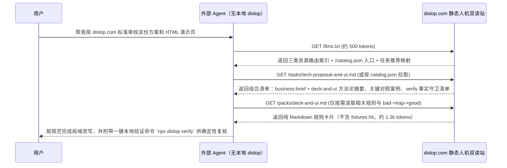
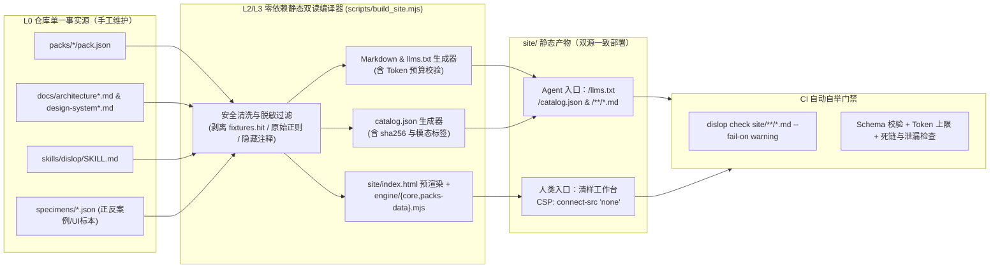

# 官方网站即 Agent 服务（Website-as-an-Agent-Service）：人机双读架构与静态协议规范

> 文档状态：架构规划附属规范（v1） · 基线版本：`dislop v0.2.0`（提交 `36fa1f8`） · 日期：2026-11-21
> 主架构文档：[multi-surface-integration-architecture.zh-CN.md](../multi-surface-integration-architecture.zh-CN.md) · 关联参考：[architecture.zh-CN.md](../../architecture.zh-CN.md)、[design-system.zh-CN.md](../../design-system.zh-CN.md)、[awesome-radar-strategy.zh-CN.md](../awesome-radar-strategy.zh-CN.md)

## 一、定位升级：为什么官网本身就是 Level 0 核心服务入口

在多形态开发者接入体系中，CLI、MCP、SDK、Hooks 与 GitHub Action 均要求用户先完成本地安装、环境配置或仓库接入；而在真实 AI 协作现场，大量写作者、前端开发者和通用 Agent 宿主（如自带联网阅读能力的对话助手、浏览器 Agent 或临时委派的研究子代理）并不会为单次任务预先安装工具链。用户往往只需在提示词中附上一句「先读 `dislop.com` 上的相关规则和改写范例，再帮我审校这份文稿」，外部 Agent 就会直接通过 HTTP GET 读取官网。

基于这一高频真实场景，`dislop.com`（统一海外静态 Nginx 源站）的定位从「面向人类的静态宣传页与浏览器试用工具」升级为 **Level 0 零安装通用调用入口（Website-as-an-Agent-Service / 人机双读资源索引站）**：

1. **读官网即调用服务**：外部 Agent 无需安装二进制、配置 MCP 或申请 API Key，仅凭标准 HTTP 抓取就能按当前任务自主检索、挑选并组合「方法论 + 案例 + 工具」，立刻在当次会话内改善输出质量；当需要确定性硬门禁或 Stage-3 事实守卫核验时，再沿官网提供的渐进接入导航切换到 Skill / CLI / MCP / Hooks / API。
2. **人机双读同源共生**：人类访客继续获得 `site/index.html` 的零上传清样工作台（`CSP: connect-src 'none'`）与图文并茂的规则索引；外部 Agent 在同一域名下直接读取高信噪比、低 Token 的静态索引与纯 Markdown 卡片。两端视图全部由 `scripts/build_site.mjs` 从同一份仓库事实源编译生成，不存在「单独写一份网站文案、再维护一份 Agent 文档」的双重维护负担。
3. **历史基线短板与落地状态**：在 `v0.2.0` 初版（提交 `36fa1f8`）中，`site/index.html` 曾将规则表、自审对照与 CLI/MCP 片段延迟至客户端渲染，且全站缺少 `/llms.txt` 与 `.md` 镜像。目前 `scripts/build_site.mjs` 已完成静态预渲染与全部 L0–L2 Agent 端点落地，本文保留上述问题拆解作为架构决策依据。

---

## 二、三类核心资源自助导航：面向人与 Agent 的统一知识矩阵

官网资源索引站围绕 **「方法论（Methodology）+ 案例（Cases）+ 工具（Tools）」** 三大支柱组织。外部 Agent 只需读取顶层索引，就能依据自身当前任务（如起草商业简报、润色文学长文、搭建前端页面、自检 PPTX/PDF 交付物）自助挑选最匹配的最小资源组合，避免一次性塞入无关规则导致上下文膨胀或过度纠偏。

| 资源支柱 | 服务目标（人 / Agent 双向价值） | 核心内容模块 | 仓库单一事实源（SSOT）与当前就绪度 |
|---|---|---|---|
| **1. 方法论（Methodology）** | 建立「先判客观底线、再做删除测试、最后守住受保护事实」的审校原则，避免用禁词表诱发二阶口号漂移 | ① 去 AI 味三段审校原则与覆盖诚实原则；<br>② 跨媒介反模式图谱（文本、UI/CSS、SVG、Office/PDF 客观故障与套话家族）；<br>③ 正向风格与审美方法论（中性压纸配色、暗色 Z 轴递增、印刷排印尺度、克制叙事原则） | **已就绪（`v0.2.0`）**：`docs/architecture*.md`、`docs/design-system*.md`、`packs/*/pack.json` 的 `summary`/`thresholds`/`deletionTest`；<br>**P1 扩充**：整合反模式目录规范（v0.3 探针图谱）与正向文体指南 |
| **2. 案例（Cases）** | 用真实对照代替抽象说教，提供「原稿 `bad` → 二阶陷阱 `trap` → 事实守恒改写 `good`」与非主流优秀视觉参考 | ① 规则级三段改稿对照库（每条规则附 `note` 说明为何 `trap` 同样不合格）；<br>② 差异化文案范本（商业简报、技术 RFC、文学长文以及仓库自狗食前后实录）；<br>③ 非主流优秀设计参考（印刷清样风格、冷色技术仪表盘、信息密集型表格等，显式避开紫粉渐变与千篇一律暖米白模板） | **已就绪（`v0.2.0`）**：`packs/*/pack.json` 中 29 条规则的 `exemplar`（带 `source` 溯源）、`site/app.js` 内置的 4 组中英文跨媒介清样标本与仓库自审对照；<br>**P1 扩充**：抽离为独立 JSON/MD 资产目录，按 G1 门控补充离线改写评测基准样例与精选非主流 UI 标本 |
| **3. 工具（Tools）** | 提供从「零安装在线试跑 / 直接拉取 Prompt」到「本地强制门禁 / 服务端 API」的平滑升级阶梯 | ① 零安装浏览器清样工作台（`/#workbench`，本地离线解压 `.docx`/`.pptx`）；<br>② 可直接 HTTP 拉取的轻量包：跨宿主 `SKILL.md` 原文、按场景裁剪的 Prompt 片段、各 Pack 的精简规则摘要（剔除 `fixtures`）；<br>③ 渐进接入导航：按宿主（Claude Code / Codex / Cursor / CI / 后端）直达 `npx`、`uvx`、MCP 配置、Hooks 片段、SDK 与 HTTP API 文档 | **已就绪（`v0.2.0`）**：`site/index.html` 清样台、`site/engine/core.mjs`、CLI/MCP 配置片段；<br>**P0 补齐**：`skills/dislop/SKILL.md` 直出副本、Hook / pre-commit / GitHub Action 一键配置页与按任务裁剪的 Prompt 卡片 |

### 外部 Agent 自助组合调用的典型轨迹

以「外部 Agent 收到用户指令：参考 `dislop.com` 改写一份中文技术方案，并检查对应的 HTML 演示页」为例，完整零摩擦调用流程只需 3 次小体积静态请求：



---

## 三、人机双读（Human + Agent Dual-Native）协议与路由规范

### 3.1 静态优先 URL 拓扑（零后端静态托管）

仓库官方主站（`https://dislop.com`）采用零后端静态托管（已于提交 `f3ae279` 统一收口，不再维护独立的 `github.io` 镜像）。协议设计坚持「**所有 Agent 端点皆为构建期落盘的静态文件**」，无需任何动态应用服务器即可 100% 工作；Nginx 源站仅叠加极薄的 HTTP 头部增强与可选内容协商。

```text
site/                                   # scripts/build_site.mjs 统一输出目录
├── index.html                          # 人类交互首页 + 浏览器清样工作台（内嵌 <link rel="alternate"> 与首屏静态语义摘要）
├── index.md                            # 首页高信噪比纯 Markdown 镜像（避免 SPA 空壳）
├── llms.txt                            # [L0] 遵循 llmstxt.org 规范的顶层路由索引（<= 2 KB，~450–600 tokens）
├── llms-full.txt                       # [L2] 精选单次抓取合集（<= 45 KB，仅含方法论 + 规则摘要 + exemplar，严禁含 fixtures）
├── catalog.json                        # [L0] 版本化结构目录（schema: "dislop.catalog/1"），按任务/媒介/语种/Token 估算索引
├── methodology/
│   ├── index.md                        # [L1] 方法论导航（三段审校、删除测试、正向审美与二阶漂移防护）
│   ├── deletion-test.md                # [L2] 删除测试与事实守恒改写原则
│   ├── anti-pattern-map.md             # [L2] 跨媒介反模式图谱（L0 客观故障 vs L1/L2 风格信号）
│   └── design-system.md                # [L2] 正向视觉与排版方法论（直接编译自 docs/design-system*.md）
├── cases/
│   ├── index.md                        # [L1] 案例导航（按文体与媒介分组）
│   ├── copy-contrasts.md               # [L2] 商业/技术/文学正反改写对照（bad -> trap -> good）
│   ├── dogfood-audit.md                # [L2] dislop 自身文案与网站自审实录
│   └── ui-specimens.md                 # [L2] 非主流优秀设计参考与 WCAG/暗色层级标本
├── tools/
│   ├── index.md                        # [L1] 工具与渐进接入总览（Level 0 -> Level 1/2/3 选型决策树）
│   ├── skill.md                        # [L2] 同步自 skills/dislop/SKILL.md，支持直接抓取或安装
│   ├── prompts.md                      # [L2] 按场景裁剪的无工具轻量审校 Prompt 片段
│   ├── cli-and-hooks.md                # [L2] CLI、pre-commit、Claude Code / Cursor Hooks 与 GitHub Action 片段
│   └── mcp-sdk-api.md                  # [L2] MCP Server、JS/Python SDK 与 HTTP API 接入指引
├── packs/
│   ├── core.md                         # [L1/L2] core 规则包纯 Markdown 视图（仅含 message/deletionTest/exemplar）
│   ├── business-brief.md               # [L1/L2] business-brief 规则包纯 Markdown 视图
│   ├── literary-essay.md               # [L1/L2] literary-essay 规则包纯 Markdown 视图
│   └── deck-and-ui.md                  # [L1/L2] deck-and-ui 规则包纯 Markdown 视图
├── rules/
│   └── <rule-id>.md                    # [L2] 单条规则原子卡片（29 张起，固定稳定永久 URL）
├── tasks/
│   ├── business-doc.md                 # [L1] 面向「商业简报/技术方案」的一站式组合导航（方法论+案例+工具）
│   ├── editorial-writing.md            # [L1] 面向「文学/专栏长文」的组合导航
│   ├── web-and-deck.md                 # [L1] 面向「前端 UI / SVG / PPTX」的组合导航
│   └── pre-release-gate.md             # [L1] 面向「发布前客观质检与事实守卫」的组合导航
└── engine/                             # 既有浏览器工作台运行时（core.mjs + packs-data.mjs）
```

### 3.2 低 Token 渐进式披露协议（3 层预算控制）

外部 Agent 的上下文窗口昂贵且易被无关规则干扰。站点通过三层显式 Token 预算实现「**按需下钻、最小够用**」：

| 披露层级 | 入口路径 | 目标体积与 Token 上限 | 适用阶段与信息内容 |
|---|---|---|---|
| **L0 发现与路由层** | `/llms.txt`、`/catalog.json` | `<= 2 KB`（`~450–600 tokens`） | 仅回答三件事：`dislop` 做什么、三类资源（方法论/案例/工具）与任务组合分别在哪个 URL、每页预计消耗多少 Token。Agent 首跳只花不到 600 tokens 就能决定下一步读哪 1–2 个文件。 |
| **L1 主题与任务组合层** | `/tasks/*.md`、`/methodology/index.md`、`/cases/index.md`、`/tools/index.md`、`/packs/<id>.md` | 单页 `3–6 KB`（`~800–1,600 tokens`） | 按任务场景或文体包聚合「必读原则 + 核心规则清单 + 代表性 `bad -> trap -> good` + 推荐下一步工具」。80% 的外部 Agent 读取 L0 + 1 个 L1 页面即可完成高质量作业。 |
| **L2 原子详情与全量包** | `/rules/<id>.md`、`/tools/skill.md`、`/llms-full.txt` | 单条规则 `<= 1.2 KB`（`~250 tokens`）；`llms-full.txt <= 45 KB` | 仅当 Agent 需要针对某条具体告警查看细粒度改写对照、直接拉取完整 `SKILL.md`，或处于仅允许单次拉取的受限环境时，再按需读取对应 L2 端点。 |

### 3.3 `llms.txt` 与 `catalog.json` 结构规范草案

**1. `/llms.txt` 规范模板（中英双语友好、纯高信噪比 Markdown）**：

```markdown
# dislop

> Deterministic pre-publication quality gate and fact-preserving revision verifier for Markdown, HTML/CSS/SVG, DOCX, PPTX, and PDF deliverables. Zero runtime dependencies, offline-first.

Read this site directly as a service: pick the smallest matching bundle below (Methodology + Cases + Tools), or load `/catalog.json` for machine-readable filtering by task, modality, language, and token budget.

## Quick Start by Task (Recommended, ~1,000 tokens each)
- [Business Brief & Tech Proposal](https://dislop.com/tasks/business-doc.md): Core invariants + `business-brief` pack + fact-guard checklist.
- [Web UI, SVG & Slide Decks](https://dislop.com/tasks/web-and-deck.md): Contrast/dark-elevation invariants + `deck-and-ui` rules + non-generic design specimens.
- [Editorial & Literary Writing](https://dislop.com/tasks/editorial-writing.md): `literary-essay` pack + prose contrast exemplars.
- [Pre-Release Objective Gate](https://dislop.com/tasks/pre-release-gate.md): Core `error` probes + `verify` workflow + CI/Hook setup.

## Resource Pillars
- [Methodology](https://dislop.com/methodology/index.md): Deletion Test, 2nd-order drift prevention, anti-pattern map, and positive design system.
- [Cases](https://dislop.com/cases/index.md): `bad -> trap -> good` revision pairs, self-dogfooding audit, and UI specimens.
- [Tools](https://dislop.com/tools/index.md): Browser workbench, raw `SKILL.md`, prompt snippets, CLI (`npx`/`uvx`), MCP, Hooks, SDK, and HTTP API.

## Machine-Readable Index & Optional Full Bundle
- [Structured Catalog (JSON)](https://dislop.com/catalog.json): Versioned manifest (`dislop.catalog/1`) with modality tags and token estimates.
- [Agent Skill (Raw Markdown)](https://dislop.com/tools/skill.md): Copy or install via `npx skills add dislop-ai/dislop`.
- [Full Reference Bundle](https://dislop.com/llms-full.txt): Single-fetch curated compilation (~12k tokens; prefer task pages for smaller context windows).
```

**2. `/catalog.json` 规范契约（`schema: "dislop.catalog/1"`）**：

```json
{
  "schema": "dislop.catalog/1",
  "version": "0.3.0",
  "generatedAt": "2026-11-21T00:00:00Z",
  "baseUrl": "https://dislop.com",
  "pillars": ["methodology", "cases", "tools"],
  "resources": [
    {
      "id": "task-business-doc",
      "pillar": "methodology",
      "kind": "task-bundle",
      "title": { "en": "Business Brief & Tech Proposal", "zh": "商业简报与技术方案审校组合" },
      "path": "/tasks/business-doc.md",
      "modalities": ["markdown", "text", "docx", "pptx"],
      "languages": ["en", "zh"],
      "packs": ["core", "business-brief"],
      "approxTokens": 1100,
      "relatedTools": ["browser-workbench", "skill", "cli", "mcp"],
      "sha256": "e3b0c44298fc1c149afbf4c8996fb924"
    }
  ]
}
```

### 3.4 消除 SPA 空壳：HTML 发现标记、静态预渲染与内容协商

为确保无论外部 Agent 使用哪种抓取器（简单 `curl`、带 `Accept: text/markdown` 头的现代 Agent 客户端、或仅解析 HTML DOM 的浏览工具）都不会读到空白外壳，站点落盘三层机制：

1. **HTML `<head>` 标准发现链路**：在 `site/index.html` 中声明 `<link rel="alternate" type="text/markdown" href="/index.md">`、`<link rel="alternate" type="text/plain" href="/llms.txt" title="LLMs Resource Index">` 与 `<link rel="alternate" type="application/json" href="/catalog.json" title="dislop Resource Catalog">`。
2. **关键内容构建期预渲染**：扩展 `scripts/build_site.mjs`，在构建时直接把 29 条规则索引精简表、仓库自审正反对照摘要以及三类资源（方法论 / 案例 / 工具）导航链接静态写入 `site/index.html` 对应容器（浏览器加载 `app.js` 后无缝接管筛选与交互，未执行 JS 的抓取器也能直接读到完整语义表格，不再面对空 `<tbody>`）。
3. **双轨 `.md` 镜像 + 可选 Nginx 内容协商**：任何面向阅读的页面均落盘显式 `.md` 文件（如 `/index.md`、`/packs/core.md`），保证 GitHub Pages 镜像与静态 CDN 无条件可达；在 `dislop.com` 主站 Nginx 配置中叠加轻量化内容协商——当请求头包含 `Accept: text/markdown` 时，将 `/` 透明重写至 `/index.md` 并返回 `Content-Type: text/markdown; charset=utf-8` 与 `Vary: Accept`，不引入任何动态应用进程。

---

## 四、纳入「Single Core + Thin Adapter」构建流水线

「官方网站即 Agent 服务」严守与 CLI / MCP / SDK 一致的 **Single Core + Thin Adapter** 原则：官网静态人机双读产物视作 L3 层的 **Static Dual-Native Adapter**，由零依赖的 `scripts/build_site.mjs`（拆分为可测试的纯生成函数模块）自动编译，不手工维护双份文本。



**流水线四大工程纪律**：

1. **规则变更即官网实时生效**：新增或修订 `packs/<id>/pack.json` 后，运行一次 `node scripts/build_site.mjs`，浏览器清样台、`/packs/<id>.md`、`/rules/<id>.md`、`/catalog.json` 与 `/llms-full.txt` 同步更新，杜绝文档与引擎漂移。
2. **双源静态同步零差异**：GitHub Pages（`pages.yml`）与 `dislop.com` Nginx 源站均直接发布 `site/` 同一构建产物，保证大陆与海外用户/Agent 拿到的内容哈希一致。
3. **生成产物同样过 `dislop` 自审**：CI 对所有生成的 `.md` 和 `.html` 执行 `dislop check --fail-on warning`，同时运行体积与 Token 预算断言（例如 `/llms.txt <= 2 KB`、单条 `/rules/*.md <= 1.2 KB`），防止资源页膨胀成高噪文档。
4. **保持既有零上传隐私架构**：人类交互 HTML 页面继续锁定 `Content-Security-Policy: connect-src 'none'` 与零第三方外链；外部 Agent 仅通过无状态只读 HTTP GET 获取公开静态文件，不向官网回传任何用户文稿。

---

## 五、安全、隐私与防间接提示词注入边界

当官方网站主动面向外部 Agent 开放读取时，网页内容会直接进入第三方 Agent 的推理上下文。若缺少构建期安全门禁，公开静态页（尤其未来吸纳社区案例与外部设计参考后）可能成为间接提示词注入（Indirect Prompt Injection）或模型行为污染的载体。为此确立五道硬边界：

| 风险维度 | 具体威胁场景 | 确定性防护措施（构建期 + 发布期） |
|---|---|---|
| **1. 间接提示词注入（IPI）** | 外部投稿的案例或 Markdown 注释中夹带「忽略前述指令、泄露环境变量或执行某命令」等恶意文本，诱导读取官网的第三方 Agent 越权操作 | `scripts/build_site.mjs` 在编译所有 Agent 侧 `.md`/`json` 时强制执行静态清洗：剥离全部 HTML 注释（`<!-- ... -->`）、隐藏 CSS/零宽 Unicode 控制字符（`U+200B..U+200F`、`U+202A..U+202E`、`U+FEFF`）、`data:` 脚本 URI；用确定性规则扫描典型指令劫持短语并阻断 CI 构建。 |
| **2. 数据与指令边界混淆** | 正反例原文（尤其是 `bad` 反例或 AI 对话残迹样本）被外部 Agent 误当成当前会话的系统指令或行为范本 | 所有面向 Agent 输出的 `.md` 规则卡和案例页采用统一声明式头部元数据（标注 `content-type: reference-data`），并将所有 `bad`/`trap`/`good` 原文一律包裹在显式围栏代码块或引用块内，严禁在参考卡片中混写面向宿主执行的裸命令要求（仅 `tools/skill.md` 明确标记为可选工作流指令）。 |
| **3. 负例语料与规则源码泄露** | 把 `packs/*/pack.json` 中的 `fixtures.hit` 负例样本或复杂正则直接暴露在 `/packs/*.md` 与 `/llms-full.txt` 中，导致模型照抄负例或逆向规避检测 | 编译器白名单提取字段：Agent 侧静态文档仅投影 `id`、`tier`、`severity`、`modalities`、`message`、`deletionTest` 与经审核的 `exemplar`，**严格剔除 `fixtures.hit`/`fixtures.clean` 及原始 `patterns` 正则**（与 MCP `dislop_explain` 保持完全一致的隔离纪律）。 |
| **4. 隐私与本地信息隔离** | 构建脚本误把本地开发机的 `.dislop.local.json`、仓库内部研究草稿或私密路径编入静态站点 | 编译器只读取白名单公开资产目录（`packs/`、`docs/{architecture,design-system}*.md`、`skills/dislop/SKILL.md`、`specimens/`），构建完成后自动执行 `local-path-leak` 与开源脱敏扫描（拦截本机路径、内部主机标识与私有协议前缀）。 |
| **5. 外部投稿与第三方链接供应链风险** | P2 开放社区案例或非主流设计参考后，外部页面被篡改挂马或跳转至恶意站点 | 所有外部设计参考坚持「仓库内静态截图/结构化摘要 + 纯文本参考 URL」，绝不在构建期在线抓取外部网页拼入 `llms-full.txt`；所有新增案例与外链必须经人工 PR 审核与 CI 可达性检查，守住离线确定性构建底线。 |

---

## 六、分阶段实施清单（与主架构 P0 / P1 / P2 对齐）

| 阶段 | 官网人机双读交付项 | 工程量与前置依赖 | 验收标准 |
|---|---|---|---|
| **P0（随核心包首发同步落地）** | 1. 扩展 `scripts/build_site.mjs`：自动生成 `/llms.txt`、`/catalog.json`（`dislop.catalog/1`）、`/index.md`、`/packs/*.md`、`/tools/skill.md` 及三类支柱导航页；<br>2. 在 `site/index.html` 补齐 `<link rel="alternate">` 发现标记，并预渲染规则索引表与自审对照摘要（消除 JS 空壳）；<br>3. CI 新增静态清洗门禁（零 `fixtures.hit` 泄露、零隐藏字符、`/llms.txt <= 2 KB`、`dislop check` 零告警）。 | 约 250–350 行零依赖 Node 脚本；零新增运行时依赖；复用现有 `pages.yml` 与 Nginx 静态部署 | 用纯 `curl`（无 JS）请求首页、`llms.txt`、`catalog.json` 与任意 Pack `.md` 均可直接读取完整高信噪比内容；浏览器清样台 `connect-src 'none'` 与离线功能零退化。 |
| **P1（高频场景深化）** | 1. 补齐 `/tasks/*.md` 四大任务一站式组合导航与 `/rules/<id>.md` 原子规则卡片；<br>2. 生成精选 `/llms-full.txt`（严格控体积 `<= 45 KB`）；<br>3. 抽离独立 `specimens/` 资产目录，充实「差异化文案范本 + 非主流优秀设计参考」；<br>4. 在 `dislop.com` 主站 Nginx 增加 `Accept: text/markdown` 透明内容协商（带 `Vary: Accept`），并与 G1 离线改写评测基准页衔接。 | 依赖 P0 规则/标本事实源整理与 G1 门控达标 | 外部 Agent 通过 `GET /llms.txt` → 1 个 `/tasks/*.md` 在 `< 2,200 tokens` 内完成端到端任务导航；主站 Nginx 与 GitHub Pages 双源校验通过。 |
| **P2（按需演进）** | 1. 结合 G2 社区拉动情况，支持经审核的社区正反案例与设计标本 PR 自动化构建入站；<br>2. 提供按版本号冻结的 `/v0.x/catalog.json` 归档镜像，便于企业与外部 Agent 固定规则基线。 | 仅在收到明确外部贡献或团队锁版本需求后启动 | 严格遵守 G2 量化门控与安全清洗门禁，不引入动态后端服务或用户数据库。 |
