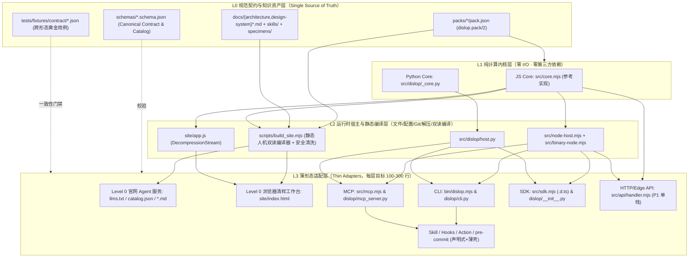

# `dislop` 多形态开发者集成与使用模式架构规划

> 文档状态：架构规划草案（v1.1，增补 Website-as-an-Agent-Service 人机双读架构） · 基线版本：`dislop v0.2.0`（提交 `36fa1f8`） · 日期：2026-11-21
> 关联参考：[architecture.zh-CN.md](../architecture.zh-CN.md)、[anti-slop-landscape-2026.zh-CN.md](./anti-slop-landscape-2026.zh-CN.md)、[strategy-and-roadmap.zh-CN.md](../strategy-and-roadmap.zh-CN.md) · 附属专项规范：[website-as-agent-service.zh-CN.md](./multi-surface-architecture/website-as-agent-service.zh-CN.md)

## 核心架构判断

在开发工具早期，提供多样化的接入入口决定冷启动转化率，但多入口若各自演化则会迅速拖垮小团队维护能力。围绕 `dislop`「Agent 交付物印前检查（Preflight Check）」的产品定位，本规划确立五项工程判断：

第一，入口广覆盖而判定单源化。开发者可以在官方网站、终端、IDE、Agent 宿主、业务代码、CI 流水线或工作流引擎中选用各自顺手的形态，但规则加载、掩码视图、探针判定、受保护事实核验、严重级与错误码语义全部收口到同一套规范契约（Canonical Contract），各形态严格限定为薄适配层（Thin Adapter）。

第二，**官方网站本身即核心使用模式与 Level 0 通用服务（Website-as-an-Agent-Service）**。`dislop.com` 兼任面向人类的浏览器清样台与面向外部 Agent 的零安装人机双读资源索引站。在大量真实任务中，外部 Agent 直接抓取官网就是在使用 `dislop` 服务——通过低 Token 渐进式披露自主组合「方法论 + 案例 + 工具」，按需完成当下任务，并在需要确定性硬门禁时平滑过渡到 Skill / CLI / MCP / Hooks / API。

第三，差异化只落在「触发时机与交互壳」，绝不落在「规则引擎分叉」。同源内核与单一资产事实源决定「查出什么、提供哪些方法论与案例、是否放行」；不同形态只在触发方式、输入粒度、Token 密度、输出协议和失败后改稿编排上做场景化裁剪。

第四，P0 先解决「未上架」「被动调用」与「官网对 Agent 呈空壳」三处主阻断。`v0.2.0` 的双端零依赖引擎和清样工作台已经成型，当前最影响外部采用的三个缺口分别是「缺少 npm/PyPI 正式发包」「MCP 仅靠模型自觉调用、缺少 Skill 与 Hooks 强制触发」以及「官网核心规则与案例全靠客户端 JS 渲染、缺少 `llms.txt` 与纯 Markdown 静态接口」。近期工程投入应优先向正式发包、官网人机双读静态编译、跨宿主 `SKILL.md`、Agent Hooks、GitHub Action、pre-commit 以及 JS/Python SDK 门面抽离倾斜。

第五，双端运行时明确主次边界，避免服务端维护翻倍。以纯 JS 核心（`src/core.mjs`）作为参考实现与全形态主干（覆盖官网双读静态构建、浏览器工作台、Node CLI/MCP/SDK、以及后续 HTTP API / Serverless / Action）；Python 端（`src/dislop/`）专注「零依赖本地 CLI + stdio MCP + Python SDK」，明确不在 Python 端重复建设 HTTP 服务或插件编排层。

---

## 一、仓库现状盘点与缺口诊断

### 1.1 现有形态与工程资产盘点（基线 `v0.2.0`）

经核查仓库源码（`v0.2.0` 已合入 `main` 分支，工作区当前干净，核心代码合计 5,829 行零外部运行时依赖），当前各接入形态的真实成熟度如下：

| 形态 | 现状载体（代码规模） | 成熟度 | 已有核心能力 | 关键缺口与使用摩擦 |
|---|---|---|---|---|
| **Node CLI** | `bin/dislop.mjs`（900 行）+ `src/binary-node.mjs`（112 行） | 高 | `check`/`verify`/`explain`/`packs`/`pack-test`/`init`；支持 stdin `-`、`--changed`/`--staged`、5 种输出格式（`text`/`json`/`sarif`/`github`/`md`）、退出码 `0/1/2` | CLI、文件装配、配置加载与 MCP 混写在同一文件；手写 `parseFlags` 对未知参数静默忽略；尚未发布 npm，文档仍要求 `npx github:` 拉仓 |
| **Python CLI** | `src/dislop/cli.py`（459 行）+ `engine.py`（1,576 行） | 高 | 与 Node CLI 共享一致子命令和退出码，通过 `tests/test_conformance.py` 跨端验证 | `pack-test` 缺少无界 `.*` 正则安全校验；`verify` 缺 `--filename` 与 `--format json`；尚未发布 PyPI，文档仍指向 `uvx --from git+...` |
| **MCP Server** | `bin/dislop.mjs:621-853` & `src/dislop/mcp_server.py`（264 行） | 中 | 零依赖 stdio JSON-RPC 2.0，提供 `dislop_check`/`dislop_verify`/`dislop_explain`/`dislop_packs` 四个工具，支持工作区路径越界拦截 | 仅有被动 `tools`，缺 `resources` 与 `prompts`；返回体 Token 偏重；`dislop_explain` 忽略 `lang` 且回传 `fixtures`；配置不热重载；仅支持单文件检查 |
| **JS/TS SDK** | `package.json` 导出 `src/core.mjs`（1,624 行） | 低 | 暴露纯内存级函数（`auditText`、`verifyRevision` 等），无 `node:*` 或 DOM 依赖 | 缺少 `.d.ts` 类型声明；`loadAllPacks`/`loadConfig`/`inspectSingleFile` 被锁在 `bin/dislop.mjs`；`src/binary-node.mjs` 未入 `exports`，调用方无法直接审查本地 `.docx`/`.pptx`/`.pdf` |
| **Python SDK** | `src/dislop/__init__.py`（3 行）+ `engine.py` | 低 | `engine.py` 已有完整函数，可内部导入 | `__init__.py` 仅导出 `__version__`；无顶层公共门面、无 `TypedDict`/`dataclass` 类型与 `py.typed` 标记，对外契约未稳定 |
| **官方网站 & Browser 工作台** | `site/index.html` + `site/app.js`（894 行）+ `scripts/build_site.mjs` | 人类交互高 / Agent 可读无 | 零上传静态清样台（`CSP: connect-src 'none'`），浏览器原生 `DecompressionStream` 解析 `.docx`/`.pptx`，与 `src/core.mjs` 自动同步并受 CI 守卫 | 规则表（`#rules-tbody`）、自审对照（`#dogfood-bad-text`）、标本库与集成片段均靠 `app.js` 客户端渲染，缺少 `/llms.txt`、结构化 JSON 目录与纯 `.md` 镜像；外部 Agent 抓取官网仅得空壳 DOM，无法将官网作为零安装服务直接调用 |
| **Agent Skill** | 仓库缺失 | 无 | — | 缺少符合 `agentskills.io` 规范的 `skills/dislop/SKILL.md`，未接入 `skills.sh` 分发渠道 |
| **Agent Hooks / CI Action / pre-commit** | 仅仓库自带 `.github/workflows/ci.yml` | 低 | CLI 已具备 `--changed`、`--staged`、`--format sarif/github` 底层能力 | 缺外部团队开箱即用的 `action.yml`、`.pre-commit-hooks.yaml`、Claude Code / Cursor Hook 模板与精简 Hook 输出格式 |
| **HTTP API / Workflow 节点** | 仓库缺失 | 无 | `src/core.mjs` 已具备无 I/O、零依赖、可跑 Edge/Node 的内核前提 | 缺无状态 REST 适配层、OpenAPI 3.1 契约、容器镜像与 Dify/n8n 接入模板 |

### 1.2 源码级核实的八项具体缺口与契约漂移

逐行对照 `bin/dislop.mjs`、`src/dislop/cli.py`、`src/dislop/mcp_server.py`、`site/index.html`、`scripts/build_site.mjs`、`package.json`、`pyproject.toml` 与 `server.json`，可定位八处必须优先收敛的具体问题：

1. **Node 运行时装配层未与 CLI 解耦**：`bin/dislop.mjs` 同时承担命令行入口、目录遍历、配置合并（`.dislop.json` + `.dislop.local.json`）、Git diff 解析、文件读取、Pack 加载和 MCP Server 全部职责。这导致 JS SDK、未来 HTTP API 和测试脚本都无法复用 Node 侧宿主装配能力，只能重复造轮子。
2. **双端 CLI 行为存在隐蔽分叉**：
   - 正则安全检查不一致：Node `bin/dislop.mjs:575-579` 在 `pack-test` 中禁止规则正则包含无界 `.*`，Python `src/dislop/cli.py:329-364` 未执行该校验；
   - 参数容错不一致：Node 手写 `parseFlags` 会静默吞掉拼错的参数（例如 `--failon`），而 Python `argparse` 会按预期返回退出码 2；
   - 子命令参数面不一致：Node `verify` 支持 `--filename` 和 `--format json`，Python `verify` 缺少 `--filename`，且 `verify`/`explain`/`packs` 均不支持 `--format json`。
3. **CLI JSON 与 MCP 响应结构未统一**：CLI `check --json` 返回 `{ version, checkedCount, skipped, findings, unusedSuppressions }`，而 MCP `dislop_check` 返回 `{ pack, modality, checked, skipped, count, protectedFacts, findings }`。缺少统一的版本化结果信封（Canonical Envelope）与标准错误码，后续再加 SDK 和 HTTP API 时结构分叉会指数级放大。
4. **MCP 存在上下文污染、Token 膨胀与能力残缺**：
   - `dislop_explain` 在双端 `inputSchema` 中均声明了 `lang` 参数（`bin/dislop.mjs:679`、`src/dislop/mcp_server.py:83`），但实际处理分支完全忽略 `lang`，直接返回整条规则 JSON——连带把 `fixtures.hit` 负例样本一起塞进模型上下文，既浪费 Token，又可能污染模型的后续生成；
   - `dislop_check` 无论命中 0 条还是 50 条，都全量返回双语 `message`/`deletionTest`、完整 `exemplar` 和全部 `protectedFacts`（且使用 2 空格缩进美化输出），在长文档多轮 Agent 循环中上下文开销偏高；
   - 仅支持单文件 `path` 或单段 `text`，不支持批量 `paths[]` 或 Git 变更范围；`dislop_verify` 缺失 CLI 已有的 `allowFactDrop` 选项；
   - 双端 MCP 均只在进程启动时调用一次 `loadConfig(cwd)`，会话中途修改 `.dislop.json` 或 `.dislop.local.json` 不会生效；
   - Node MCP `bin/dislop.mjs:833` 调用 `pickPackForFile(rel, ...)` 时未将 `rel` 统一为 POSIX 斜杠（而同函数第 823 行做了转换），在 Windows 下会导致 `overrides` glob 匹配失效。
5. **被动调用与触发摩擦**：既有生态调研（[anti-slop-landscape-2026.zh-CN.md](./anti-slop-landscape-2026.zh-CN.md)）指出，头部项目（如 `impeccable`、`taste-skill`）已将编辑钩子与 SARIF 扫描内置化。`dislop` 若只靠开发者记住跑命令或指望模型主动想起调用 MCP，真实使用频次会大幅衰减。
6. **发布元数据与安装指引错位**：`server.json` 已声明 npm 包 `dislop@0.2.0` 与 PyPI 包 `dislop@0.2.0`，但 `README.md` 仍指引通过 `npx --yes github:dislop-ai/dislop` 与 `uvx --from git+...` 拉取 Git 源码。前者容易在官方 MCP Registry 审核或一键安装时失败，后者冷启动慢且受 Git 网络环境影响大。
7. **二进制输入仅绑定本地文件路径**：当前 `.docx`/`.pptx`/`.pdf` 解析强依赖磁盘文件读取，CLI stdin 仅支持 UTF-8 文本。面向 SDK（内存 `Uint8Array`/`bytes`）与 HTTP API（`multipart/form-data` 上传）时，需把「字节流入口」提升为内核适配层的一等输入。
8. 官网呈客户端渲染空壳，尚未面向外部 Agent 开放人机双读服务：
   - 核查 `site/index.html` 可见，标本区（第 93 行 `#specimen-list`）、自审正反例（第 154 行 `#dogfood-bad-text`）、29 条规则索引表（第 196 行 `#rules-tbody`）和 CLI/MCP 配置片段（第 269 行 `#snippet-code`）在静态 HTML 中均为空容器，完全依赖 `site/app.js` 运行时填充；
   - `scripts/build_site.mjs` 目前仅同步 `engine/core.mjs` 与 `engine/packs-data.mjs`，尚未产出 `/llms.txt`、结构化 JSON 资源目录或高信噪比纯 Markdown 镜像，导致具备联网读取能力的外部 Agent 无法通过直接访问 `dislop.com` 获取方法论、案例与工具导航。

---

## 二、多形态集成矩阵：同源内核 vs 场景差异化规划

### 2.1 共享内核不变量 vs 形态专属差异化边界

多形态架构的核心纪律是把「什么必须绝对一致」与「什么必须按场景拉开差异」写死在边界上：

- **必须 100% 跨形态保持一致的六项内核能力**：
  1. 规则包加载与合并语义（`dislop.pack/2` 继承链、`core` 不可关闭、`.dislop.json` 与 `.dislop.local.json` 叠加顺序、`allow`/`forbid`/`overrides` 生效优先级）；
  2. 模态识别与长度保持掩码（`raw`、`prose`、`ui-text` 视图构造、行内 `dislop-ignore-next-line` 抑制解析及过期检测）；
  3. 确定性探针算法、Unicode 码点列号坐标（1-based）、FNV-1a 指纹及覆盖诚实原则（无法解析的加密 PDF 或损坏压缩包必须显式上报 `skipped`，禁止静默判干净）；
  4. 严重级排序（`info < warning < error < never`）与 `failOn` 阻断判定逻辑；
  5. Stage-3 事实守卫引擎（`extractProtectedFacts` 多重集比对与 `DISPLACEMENT_FAMILIES` 二阶漂移拦截）；
  6. 零 LLM 基础体检与默认离线隐私原则。

按形态刻意差异化的五个交互维度如下表所示：

| 差异化维度 | 各形态的场景化分工 |
|---|---|
| 触发机制 | 外部 Agent 直接读取官网导航（Website-as-a-Service，Level 0 零安装）、人工主动执行（CLI / 工作台）、对话意图激活（Skill）、模型按需拉取（MCP）、文件写入或提交自动拦截（Hooks / CI）、系统事件调用（SDK / HTTP API） |
| 输入粒度 | 官网按任务/媒介/规则静态只读检索；执行形态支持单段内存文本、单文件、目录树、Git Diff 行区间、二进制字节流与多文档批处理 |
| 信息密度与 Token 预算 | 官网 Agent 侧实行 3 层低 Token 渐进披露（`/llms.txt` `~500 tokens` -> 专题/任务页 `~1,000 tokens` -> 原子规则卡 `~250 tokens`）；终端需人类可读排版与行号定位；Hooks 需 3–5 行极简纠错指令；MCP 需紧凑 JSON 与按需拉取规则详情；CI 需标准 SARIF 或 PR 注解 |
| 改稿引导方式 | 官网提供「方法论 + 案例 + 工具」自助组合导航与无工具 Prompt 片段；Skill 负责生成前防呆与改后核验编排；MCP 提供按需查询 exemplar 与严格复检；CLI 与 CI 侧重客观阻断与精准定位 |
| 鉴权与运行态隔离 | 官网全静态零鉴权、零上传、只读无状态并执行构建期防间接提示词注入清洗；本地形态零鉴权、直接读取工作区 `.dislop.local.json`；自托管或云端 HTTP API 默认无状态、不落盘正文、强制请求体限额与可选 API Key 保护 |

### 2.2 全形态集成矩阵（覆盖 Level 0 至 Level 3 共 11 类场景）

| 形态 | 生态位与阶段 | 目标开发者与宿主场景 | 复用同源内核 / 事实源方式 | 形态专属差异化能力 | 必须规避的反模式 |
|---|---|---|---|---|---|
| **0. 官方网站（Website-as-an-Agent-Service）** | **Level 0 零安装通用入口** · P0 补齐 + P1 深化 | 所有带联网阅读能力的外部 Agent（通用对话助手、研究子代理、浏览器 Agent）及首次接触的写作者、设计师与开发者 | 通过 `scripts/build_site.mjs` 从 `packs/`、`docs/`、`skills/` 与案例标本单一事实源自动编译静态人机双读产物 | **三类核心资源自助导航（方法论 + 案例 + 工具）**：提供 `/llms.txt`、`/catalog.json`、高信噪比纯 `.md` 镜像（兼可选 Nginx `Accept: text/markdown` 内容协商）与低 Token 3 层渐进式披露；外部 Agent 读官网即使用服务，并可一键跳转到浏览器工作台或安装 Skill / CLI / MCP / API | 不要依赖 SPA 客户端 JS 渲染导致 Agent 抓空壳；不要向静态 `.md`/`llms-full.txt` 倾倒 `fixtures.hit` 负例或原始正则；不要为 Agent 访问引入重型动态后端 |
| **1. CLI（Node & Python）** | Level 1 本地执行 · P0 增强 | 终端开发者、Shell 管道脚本、CI 流水线 | 直调本地 Host 层 + Core Engine | `--changed`/`--staged` 增量行过滤；stdin 管道；`0/1/2` 标准退出码；`text`/`json`/`sarif`/`github`/`md`/`hook` 多格式渲染；`init`/`pack-test` 维护命令；P1 增补 `--baseline` 基线治理 | 不要在 CLI 中内联业务规则；不要对未知参数静默放行 |
| **2. Agent Skill（`SKILL.md`）** | Level 1 宿主注入 · P0 新增 | Claude Code、Codex、Cursor、Windsurf、Antigravity 等支持 `agentskills.io` / `skills.sh` 的宿主 | 通过指令编排调用本地 MCP 或 CLI（无工具时退回精简准则，并同步直出至官网 `/tools/skill.md`） | **前置防呆 + 三步改稿编排**：按任务文体动态选择 Pack；先查后改、只改命中片段、改后必跑 `verify`；通过渐进披露（Progressive Disclosure）把上下文控制在 2 KB 以内 | 不要把全部规则和负例词表硬塞进 `SKILL.md` 正文，否则触发模型同义词替换与二阶过矫 |
| **3. MCP Server** | Level 2 协议直连 · P0 修复 + P1 升级 | IDE 与桌面/云端 Agent 宿主（stdio 为主，P1 增可选 Streamable HTTP） | 共享 Host 层与 Canonical Contract，响应层加 Token 裁剪器 | **三原语分工**：`Tools`（紧凑检查 `verbosity=compact`、批量 `paths[]`、`verify` 支持 `strict`/`ledger`）；`Resources`（只读挂载 Pack/Rule/Config，剔除 `fixtures`）；`Prompts`（`preflight-audit`/`guarded-rewrite` 斜杠命令）；配置按 mtime 热加载 | 不要向模型倾倒原始 `fixtures.hit`；不要要求模型一次传入整份 50 页二进制文档的 base64 |
| **4. Agent Hooks** | Level 2 强制拦截 · P0 新增 | Claude Code（`PostToolUse`/`Stop`）、Cursor Hooks | 调用轻量 `dislop check --format hook --fail-on error` | **零人工记忆自动拦截**：仅对写盘的文档/幻灯片/前端文件触发；单次延迟预算 `< 150ms`；默认仅对 `core` 客观 `error` 阻断，`warning` 转为非阻断提示；自带防死循环熔断（同文件连续失败超过 2 次转人工） | 不要用 `warning` 级别文风规则强行拦截每一次工具写入，以免把 Agent 锁死在无休止改写循环中 |
| **5. 编程 SDK（JS/TS & Python）** | Level 2 代码嵌入 · P0 抽离 | Node/Bun/Edge 应用、前端构建链路、Python Agent 框架（LangGraph/PydanticAI 等）、单测断言 | JS 分层导出 `dislop`（Node 全功能）与 `dislop/core`（零 I/O 纯内存）；Python 顶层导出强类型门面 | 支持内存 `string`、`Uint8Array`/`bytes`（直接检 `.docx`/`.pptx`/`.pdf` 字节流）、`Path` 三类输入；原生类型提示（`.d.ts` + `py.typed`）；与 pytest/Vitest 断言无缝结合 | 不要强迫调用方手动读 `packs/*.json` 或自行解压 ZIP 才能检一份 Word/PPT |
| **6. GitHub Action & pre-commit** | Level 2 仓库门禁 · P0 新增 | 开源仓与研发团队 PR 评审、文档站发布流水线 | 极薄 YAML 封装调用已发布的 `dislop` CLI | Action 自动识别 PR Base SHA 跑增量检查、一键上传 SARIF 至 GitHub Code Scanning、原地更新单条 Sticky PR Comment；`.pre-commit-hooks.yaml` 仅审 staged 改动 | 不要在每次 push 重复刷屏新 PR 评论；不要在旧仓库默认对未改动历史文件报错 |
| **7. HTTP API（自托管 / Serverless / 云端）** | Level 3 服务化 · P1 新增 | Go/Rust/Java 等异构后端、企业内网微服务、CMS/发稿中台、跨团队共享质检节点 | 复用纯 JS `src/core.mjs` + Web Standard `Request/Response` 处理器（单栈运行） | 无状态 REST JSON 契约（`/v1/check`、`/v1/check/batch`、`/v1/verify`、`/v1/packs`）；支持 `multipart/form-data` 上传 Office/PDF 与 JSON 文本直传；提供 OpenAPI 3.1、限流、体积上限、请求 ID；P2 视需求补异步 Webhook | 严禁默认落盘或日志记录用户正文；不要在 Python 端另起一套重复的 FastAPI 服务 |
| **8. 浏览器清样工作台（`site/#workbench`）** | Level 0 人类交互工具 · 既有维持 + P2 扩展 | 编辑、产品经理、设计师等非终端用户零门槛离线审稿（与形态 0 共用 `dislop.com` 静态域名） | `scripts/build_site.mjs` 直接同步 `src/core.mjs` 与 `packs-data.mjs` | 物理级零外传（`CSP: connect-src 'none'`）；浏览器本地解压 Office 文档；红/蓝/绿三铅笔可视化批注与「二阶陷阱对比演示」；P2 可评估可嵌入 Web Component | 绝不引入外部字体 CDN、统计脚本或后端代理，守住零上传信任基石 |
| **9. 工作流节点（Dify / n8n / Coze）** | Level 3 编排集成 · P1 衍生 | 内容运营自动化、多 Agent 编排平台 | 不手写定制 SDK 插件，直接消费 P1 HTTP API 的 OpenAPI 3.1 Schema | 通过标准 OpenAPI 导入 Dify Custom Tool，提供 n8n HTTP Request / Webhook 模板 JSON，一键接入自托管 `ghcr.io/dislop-ai/dislop-api` | 早期不要为每个低代码平台维护独立私有插件仓，成本高且易随宿主升级失效 |
| **10. IDE 编辑器实时诊断（VS Code / Zed / Neovim）** | Level 3 编辑器内嵌 · P2 评估 | 重度文档与前端代码作者 | P0 靠 CLI Problem Matcher；P2 如需实时波浪线则做极薄 LSP 包装器调用 `src/core.mjs` | 保存时实时标红 `core` 错误、悬停展示 Deletion Test 与 `bad -> trap -> good` 对照、提供一键插入带理由的 `dislop-ignore-next-line` Code Action | 早期不要分别开发 VS Code、JetBrains、Cursor 独立扩展；优先用 LSP 一次覆盖多编辑器 |

---

## 三、「单一内核 + 薄适配层」工程架构设计

### 3.1 四层架构与依赖流向

为解决早期「形态多、人手少」的核心矛盾，代码库按严格单向依赖拆为四层：上层适配层只负责协议翻译与输入输出装配，禁止包含任何正则规则、阈值判断或事实比对逻辑。



### 3.2 关键重构动作：把宿主装配层从 CLI 中解放出来

当前仓库最立竿见影的架构债务位于 `bin/dislop.mjs`（900 行）。将其拆解为四个边界清晰、职责单一的模块后，后续全部新形态（JS SDK、增强 MCP、HTTP API、Hook 格式化）都可直接复用，不再复制一行配置或文件加载代码：

| 目标模块 | 职责边界 | 上游消费者 |
|---|---|---|
| `src/core.mjs`（保持纯零环境依赖） | 文本/OOXML/PDF 确定性审查、掩码、受保护事实抽取、`verifyRevision`、多格式报告渲染 | 全部 JS 形态 + Browser Workbench + Cloudflare Workers |
| `src/binary-node.mjs`（小幅补齐 `Uint8Array` 兼容） | ZIP 中央目录解压与 PDF 流解压，接受 `Buffer`/`Uint8Array` | `src/node-host.mjs`、`src/sdk.mjs`、`src/api/handler.mjs` |
| `src/node-host.mjs`（**P0 新增抽离**） | `loadAllPacks()`、`loadConfig(cwd, opts)`（支持 mtime 缓存与热重载）、`pickPackForFile()`（强制 POSIX 路径归一化）、`collectFiles()`、`inspectFile()`、`inspectBytes()`、`getChangedLineMap()`、`resolveSafeWorkspacePath()` | `bin/dislop.mjs`、`src/mcp.mjs`、`src/sdk.mjs`、`src/api/server.mjs` |
| `src/mcp.mjs`（**P0 从 `bin/dislop.mjs` 独立**） | 纯 MCP JSON-RPC 2.0 传输协议、Tools/Resources/Prompts 路由、Token 裁剪器 | `bin/dislop-mcp.mjs`、`bin/dislop.mjs --mcp` |
| `scripts/build_site.mjs`（**P0 扩展为双读静态编译器**） | 从 `packs/`、`docs/`、`skills/` 与 `specimens/` 单一事实源同步编译浏览器工作台与 Agent 静态只读端点（`/llms.txt`、`/catalog.json`、`/index.md`、`/packs/*.md`、`/tasks/*.md`、`/rules/*.md`），内置 `fixtures.hit` 剔除与防提示词注入清洗 | `site/`（`dislop.com` 静态 Nginx 发布） |

Python 端同理将现有 `src/dislop/engine.py`（1,576 行）按「纯计算 `_core.py` + 本地宿主 `host.py` + 公共 SDK 门面 `__init__.py`」做轻量整理（保持 `from dislop.engine import ...` 向后兼容重导出，不破坏既有单测）。

### 3.3 面向 HTTP API 与 Serverless 的「一套代码双部署」设计

由于 `src/core.mjs` 本身不依赖任何 Node.js 内置模块，P1 的 HTTP API 适配层应基于 **Web Standard `Fetch API`（`(request: Request, runtime) => Promise<Response>`）** 编写：

- **本地自托管与 Docker 容器**：通过极薄的 `node:http` 桥接器启动 `dislop serve --host 127.0.0.1 --port 8787`，内置 `zlib.inflateRawSync` 作为解压器；
- **Serverless / Edge（Cloudflare Workers / Deno Deploy）**：直接导出同一 `fetch` handler，注入 Web 原生 `DecompressionStream('deflate-raw')` 作为解压器。

这套设计只需维护约 250 行核心路由与参数校验代码，零框架绑定（无需引入 Express/Fastify 依赖树），同时满足自托管内网容器与海外轻量 Edge 部署两种形态。

### 3.4 Canonical Contract：统一数据结构、严重级与跨形态错误码映射

为了杜绝 CLI、MCP、SDK、HTTP API 返回各自为政的字段命名，引入统一契约版本 `dislop.result/1`。所有形态在底层都产出同一规范对象，再由各适配层按需投影（例如 MCP `compact` 模式仅裁剪 `exemplar` 与重复文案，不改变字段名）：

**跨形态错误码与状态映射表**：

| Canonical Error Code | 语义说明 | CLI 退出码 | MCP 表现 | HTTP 状态码 | SDK 异常 / 返回 |
|---|---|---|---|---|---|
| `OK` | 审查完成，无达标阻断项 | `0` | `isError: false` | `200 OK` | 正常返回 `CheckResult` |
| `DISLOP_FINDINGS_EXCEEDED` | 命中达到 `--fail-on` 阈值的缺陷，或存在未用抑制项 | `1` | `isError: false`（`passed: false`，便于模型读结果继续修复） | `200 OK`（`passed: false`，业务审查成功而非接口故障） | 正常返回（`result.passed === false`） |
| `DISLOP_VERIFY_REJECTED` | `verify` 检测到受保护事实丢失/编造、残留 `core` 错误或二阶漂移 | `1` | `isError: false`（`ok: false` + `reasons[]`） | `200 OK`（`ok: false` + `reasons[]`） | 正常返回（`result.ok === false`） |
| `DISLOP_INVALID_INPUT` | 参数缺失、非法 `--format`/`--fail-on`、同时传入或未传 `text`/`path` | `2` | `isError: true` | `400 Bad Request` | 抛出 `DislopInputError` |
| `DISLOP_UNKNOWN_PACK` / `DISLOP_UNKNOWN_RULE` | 请求了未安装的 Pack ID 或 Rule ID | `2` | `isError: true` | `404 Not Found` | 抛出 `DislopNotFoundError` |
| `DISLOP_WORKSPACE_ESCAPE` | 文件路径或符号链接越出当前工作区根目录 | `2` | `isError: true` | `403 Forbidden` | 抛出 `DislopSecurityError` |
| `DISLOP_FILE_TOO_LARGE` | 单文件超出大小上限（默认 25 MB；API 默认 10 MB 可配） | `2`（显式单文件） | `isError: true` | `413 Payload Too Large` | 记录 `skipped` 或抛出限额错误 |
| `DISLOP_UNSUPPORTED_MODALITY` | 显式请求的扩展名或 MIME 类型不受支持 | `2`（显式单文件） | `isError: true` | `415 Unsupported Media Type` | 记录 `skipped` |
| `DISLOP_UNINSPECTABLE_ARTIFACT` | 非 UTF-8 文本、损坏 ZIP/OOXML 或加密 PDF | `2`（显式单文件） | `isError: false` + `checked: false` + `skipped[]` | `422 Unprocessable Entity`（单文件）或 `200` 内嵌 `skipped[]`（批量） | `checked: false` + `skipped[]` |

> [!IMPORTANT]
> **MCP 与 HTTP 关键语义区分**：审查命中缺陷（`passed: false`）或复检未通过（`ok: false`）属于**正常业务判定结果**，在 MCP 中应返回 `isError: false`、在 HTTP 中应返回 `200 OK`，避免 Agent 宿主误判为「工具崩溃」而中止对话或盲目重试调用；仅参数非法、越权、文件缺失等系统异常才置 `isError: true` 或 4xx/5xx。

### 3.5 防维护雪崩：跨形态契约测试与双端演进治理

#### 三层自动化一致性门禁（CI 必跑）

在持续集成中落地三层门禁，防止多形态在高频迭代中发生语义漂移：

- Pack 规则自检门禁：双端 `pack-test` 执行完全一致的规则校验集合（含正则无界 `.*` 检查、双语 `deletionTest`、正反例与 `source` 溯源）。
- Canonical Golden Fixtures 跨形态测试：在 `tests/fixtures/contract/` 维护 15–20 组代表性黄金样本（覆盖纯文本、Markdown 掩码、HTML/CSS 对比度、合成 `.docx`/`.pptx`/`.pdf`、`verify` 通过与拒收、错误输入），CI 用同一测试套件依次驱动 Node CLI、Python CLI、Node MCP、Python MCP、JS SDK、Python SDK 与 P1 HTTP API，断言核心字段（`ruleId`、`severity`、`location`、`fingerprint`、`checked`、`skipped`、`ok`、`invariants`）逐字段等价。
- 薄适配层红线巡检：所有 L3 适配层不得出现规则 ID 枚举、正则字面量或严重级数值比较，统一调用 `SEVERITY_RANK` 与 `core` 导出函数。

#### Node / Python 双端长期定位与切换阈值

在 0.x 阶段（规则数量处于 29–80 条区间），双端零依赖策略能够兼顾 `npx` 与 `uvx` 两条主流分发通路，应通过 Golden Suite 持续锁死行为一致。

仅当同时满足「规则探针超过 80 条或引入复杂 PDF 字体解码，导致双端同步耗时占总研发工时超过 25%」这一量化条件时，再评估是否将重型二进制解析抽为独立可选组件或 WASM/Rust 内核；在此之前不引入原生编译链，避免破坏零依赖秒装体验。

---

## 四、核心形态接口规范草案

以下草案面向 P0/P1 直接施工设计，所有字段均沿用 `v0.2.0` 现有命名惯例以保证向后兼容。

### 4.1 统一规范返回契约（`dislop.check/1` 与 `dislop.verify/1`）

```json
{
  "schema": "dislop.check/1",
  "version": "0.3.0",
  "passed": false,
  "failOn": "error",
  "summary": {
    "checkedCount": 1,
    "skippedCount": 0,
    "errorCount": 1,
    "warningCount": 1,
    "infoCount": 0,
    "unusedSuppressionCount": 0
  },
  "findings": [
    {
      "ruleId": "local-path-leak",
      "packId": "core",
      "tier": "invariant",
      "severity": "error",
      "family": "hygiene/path",
      "file": "docs/rollout.md",
      "modality": "markdown",
      "location": "line 14:22",
      "line": 14,
      "col": 22,
      "span": [412, 456],
      "match": "file:///Users/example/Desktop/arch.png",
      "fingerprint": "a1b2c3d4",
      "message": "残留本机文件系统路径或 file:/// 链接。",
      "deletionTest": "将个人工作站路径改为仓库相对路径或公开 HTTPS 链接。"
    }
  ],
  "skipped": [],
  "unusedSuppressions": [],
  "protectedFacts": {
    "numbers": ["up to 12 minutes", "3 nodes"],
    "dates": ["2026-11-21"],
    "urls": ["asset:arch.png"],
    "codeSpans": [],
    "codeBlocks": [],
    "citations": []
  }
}
```

> 说明：`protectedFacts` 仅在请求启用 `includeFacts: true`（默认 MCP 单文件/文本开启，CLI 多文件扫描与批量 API 关闭）时附带，避免全仓扫描输出膨胀。`message` 与 `deletionTest` 在 `lang` 指定时直接投影为目标语言字符串，完整双语对象通过 `verbosity: "full"` 或 `explain` 获取。

### 4.2 CLI 命令树规划（兼容 `v0.2.0`）

```text
dislop
├── check [paths... | -]              # 审查文件、目录、stdin 或 Git 变更
│   ├── --pack <id>                   # 强制指定审美包
│   ├── --config <path>               # 显式配置文件
│   ├── --fail-on error|warning|info|never
│   ├── --format text|json|sarif|github|md|hook   # 新增 hook 极简输出
│   ├── --changed [ref] | --staged    # Git 增量行门禁
│   ├── --stdin-filename <name>       # stdin 模态与路由提示
│   ├── --report-unused               # 报告过期行内抑制注释
│   ├── --lang en|zh                  # 提示语种
│   └── --baseline <file>             # [P1] 忽略已登记历史指纹，仅拦新增问题
├── verify [<before> <after>]         # Stage-3 事实守卫与二阶漂移复检
│   ├── --before-text / --after-text
│   ├── --filename <name>             # [P0 双端补齐]
│   ├── --pack <id> / --config <path>
│   ├── --mode strict|ledger          # [P1] strict 自动阻断；ledger 输出人审变更账本
│   ├── --allow-drop                  # 允许有意删减事实项
│   └── --format text|json            # [P0 双端补齐，兼容 --json]
├── explain <rule-id> [--lang en|zh] [--format text|json]
├── packs [--format text|json]
├── pack-test                         # 双端统一校验 Pack Schema v2 + 正则安全 + 夹具
├── init                              # 生成 .dislop.json 并把 .dislop.local.json 写入 .gitignore
├── hook <install|print> --target claude|cursor|pre-commit   # [P0/P1] 输出或安装强制门禁配置
├── serve [--host 127.0.0.1] [--port 8787] [--config <path>] # [P1 仅 Node 端] 启动本地无状态 HTTP API
└── --mcp                             # 启动 stdio MCP Server（兼容独立命令 dislop-mcp）
```

### 4.3 MCP Server 增强清单（Tools / Resources / Prompts）

**Tools（P0 修复 + P1 增量扩展）**：

| Tool 名称 | 关键入参 | 返回优化与形态差异化设计 |
|---|---|---|
| `dislop_check` | `text` / `path` / `paths[]`（P1） / `changed`（P1）、`pack`、`filename`、`lang`（默认 `en`）、`failOn`（默认 `error`）、`verbosity`（`compact` \| `full`，默认 `compact`） | `compact` 模式默认压缩为单语、去 `exemplar`、仅在 `findings.length > 0` 时附带 `protectedFacts`、采用紧凑 JSON（省去 2 空格缩进），实测可削减 50%–70% Token；每次调用按配置文件 `mtime` 检查热重载 |
| `dislop_verify` | `before`、`after`（P1 支持 `beforePath`/`afterPath`）、`pack`、`filename`、`allowFactDrop`、`mode`（`strict` \| `ledger`） | 返回 `ok`、`beforeCount`、`afterCount`、`invariants` 差异与 `displaced` 列表，方便模型精准定位被误删的限定词或二阶句式 |
| `dislop_explain` | `ruleId`、`lang`（`en` \| `zh`，P0 修复生效） | 严格返回目标语种的 `message`、`deletionTest` 与 `bad -> trap -> good` 对照，**显式剔除 `fixtures.hit/clean` 与原始正则**，杜绝模型照抄负例或逆向规避 |
| `dislop_packs` | 无 | 返回已安装审美包摘要、适用模态与规则数 |

**Resources（P1 新增，供宿主按需挂载上下文）**：

- `dislop://packs`：全部已安装审美包元数据索引（只读 JSON）
- `dislop://packs/{packId}`：指定审美包的适用模态、阈值与规则摘要列表（不含 `fixtures`）
- `dislop://rules/{ruleId}`：单条规则的删除测试与正反改稿对照卡片（Markdown 或 JSON）
- `dislop://config/effective`：当前工作区合并 `.dislop.json` 后的生效配置摘要（严格脱敏，不暴露 `.dislop.local.json` 的 `forbid` 明文敏感词）

**Prompts（P1 新增，供宿主暴露为斜杠指令）**：

- `preflight-audit`（参数：`path`、`pack?`）：引导模型先调 `dislop_check` 汇总 L0/L1/L2 问题并按优先级列整改清单，不擅自改写原稿。
- `guarded-rewrite`（参数：`path`、`pack?`）：固定执行「`dislop_check` -> 仅修改命中句段并保留全部 `protectedFacts` -> 调用 `dislop_verify` 直至 `ok: true`」三步闭环。

### 4.4 Agent Skill（`skills/dislop/SKILL.md`）触发边界与工作流草案

遵循 [agentskills.io](https://agentskills.io/specification) 跨宿主规范，将技能文件置于仓库 `skills/dislop/SKILL.md`，兼顾生成前约束与交付前确定性核验：

```markdown
---
name: dislop
description: Pre-publication quality gate and fact-preserving revision verifier for Markdown, HTML/CSS/SVG, DOCX, PPTX, and PDF deliverables. Trigger when preparing documents, decks, or UI pages for publication, or when polishing AI-generated drafts without losing numbers, dates, links, or citations.
---

# dislop Preflight Workflow

## When to Run
- Before delivering or committing documentation (`.md`/`.mdx`), UI templates (`.html`/`.css`/`.jsx`/`.svg`), Word (`.docx`), PowerPoint (`.pptx`), or PDF reports.
- Whenever rewriting a draft for clarity or tone where factual accuracy matters.

## Do NOT Run
- On unit test fixtures, vendored third-party files, or source code files outside UI/doc modalities.

## Three-Step Execution Loop
1. **Inspect**: Call MCP `dislop_check` (preferred) or run `npx dislop check <path> --format json --lang <en|zh>`.
   - Resolve every `error` (Core Invariants) first; treat `warning`/`info` as editorial queries.
2. **Targeted Edit**: Edit ONLY flagged spans using each finding's `deletionTest` (call `dislop_explain` if a rule needs a before/trap/after exemplar).
   - Keep every item in `protectedFacts` intact (numbers with qualifiers/units, dates, URLs, code spans, citations).
   - Never swap clichés into 2nd-order slogans ("It's not X, it's Y" or three-word staccato runs).
3. **Verify**: Run MCP `dislop_verify` (or `dislop verify <before> <after>`) and confirm `ok: true` before reporting completion.
```

### 4.5 Agent Hooks 与 pre-commit 强制门禁草案

针对「MCP 靠自觉调用」的短板，P0 提供三份可直接复用的薄壳配置，全部依赖 CLI 新增的 `--format hook`（仅输出 ≤ 5 行结构化纠错提示）：

**1. Claude Code `PostToolUse` 钩子片段（`.claude/settings.json`）**：

```json
{
  "hooks": {
    "PostToolUse": [
      {
        "matcher": "Write|Edit|MultiEdit",
        "hooks": [
          {
            "type": "command",
            "command": "dislop check \"$CLAUDE_TOOL_FILE_PATH\" --fail-on error --format hook"
          }
        ]
      }
    ]
  }
}
```

> 设计约束：仅对支持模态触发（不支持扩展名在 Hook 模式下直接退出 0 放行，避免阻塞源码编辑）；仅对 `core` 客观 `error` 返回非零退出码；单文件平均耗时控制在 50–150 ms 内；配套环境变量 `DISLOP_HOOK_DISABLE=1` 作为紧急逃生开关。

**2. Git `pre-commit` 配置（仓库根目录 `.pre-commit-hooks.yaml`）**：

```yaml
- id: dislop-check
  name: dislop preflight check
  description: Deterministic pre-publication gate for docs, UI, DOCX, PPTX, and PDF
  entry: dislop check --fail-on error
  language: python
  types_or: [markdown, text, html, css, jsx, tsx, svg, binary]
  files: \.(md|mdx|txt|html|htm|css|jsx|tsx|svg|docx|pptx|pdf)$
```

**3. GitHub Action 调用示例（`dislop-ai/dislop-action@v1`）**：

```yaml
- uses: dislop-ai/dislop-action@v1
  with:
    changed-only: true
    fail-on: error
    upload-sarif: true
    pr-comment: sticky
```

### 4.6 编程 SDK 接口草案（JS/TS & Python）

**JS / TypeScript（`package.json` 分层子路径导出）**：

```json
{
  "exports": {
    ".": { "types": "./types/index.d.ts", "default": "./src/sdk.mjs" },
    "./core": { "types": "./types/core.d.ts", "default": "./src/core.mjs" },
    "./packs": { "types": "./types/packs.d.ts", "default": "./src/packs-loader.mjs" }
  }
}
```

```ts
// 1. Node 全功能门面：支持文件、字节流、目录与自动加载内置 Packs / .dislop.json
import { checkFile, checkBytes, checkText, verifyRevision } from "dislop";

const report = await checkFile("./docs/q3-brief.pptx", { failOn: "error", lang: "zh" });
const ver = verifyRevision(beforeText, afterText, { pack: "business-brief", mode: "strict" });

// 2. 纯内存/浏览器/Edge 场景（零 node:* 依赖）
import { auditText, resolveEffectivePack } from "dislop/core";
```

**Python（`src/dislop/__init__.py` 顶层强类型门面）**：

```python
from dislop import check_path, check_bytes, check_text, verify_revision

report = check_path("reports/q3-review.docx", fail_on="error", lang="zh")
if not report["passed"]:
    for finding in report["findings"]:
        print(finding["location"], finding["ruleId"], finding["deletionTest"])

ver = verify_revision(before_text, after_text, pack="business-brief")
assert ver["ok"], ver["reasons"]
```

### 4.7 HTTP API 端点草案（P1，遵循 OpenAPI 3.1）

| 端点 | 方法 | 请求格式 | 核心用途与约束 |
|---|---|---|---|
| `/v1/health` | `GET` | — | 返回引擎版本、已加载 Pack 列表与运行态检查（无状态） |
| `/v1/packs` | `GET` | — | 列出可用审美包元数据 |
| `/v1/rules/{ruleId}` | `GET` | Query: `?lang=en\|zh` | 获取单条规则删除测试与改稿对照（不含 `fixtures`） |
| `/v1/check` | `POST` | `application/json`（`{text, filename, pack, failOn, lang, includeFacts}`）或 `multipart/form-data`（上传 `.docx`/`.pptx`/`.pdf` 等单文件） | 同步审查单份文本或二进制文档，返回 `dislop.check/1`；单文件默认上限 10 MB |
| `/v1/check/batch` | `POST` | `application/json`（`{items: [{id, text, filename, pack}], failOn, lang}`） | 同步批处理（默认上限 50 条 / 总计 5 MB），适合发稿中台与工作流批量质检 |
| `/v1/verify` | `POST` | `application/json`（`{before, after, filename, pack, allowFactDrop, mode}`） | Stage-3 事实守卫与二阶漂移核验，返回 `dislop.verify/1` |

安全与隐私默认值：默认监听 `127.0.0.1`（容器部署显式配置 `0.0.0.0`）；支持可选 `DISLOP_API_KEY` Bearer 鉴权；请求正文严格驻留内存，零磁盘临时文件、零正文日志输出。

### 4.8 官方网站即 Agent 服务（Website-as-an-Agent-Service / Level 0 人机双读规范摘要）

完整 URL 拓扑、`/llms.txt` 模板、`dislop.catalog/1` Schema、内容协商与防间接提示词注入细则见附属专项规范：[website-as-agent-service.zh-CN.md](./multi-surface-architecture/website-as-agent-service.zh-CN.md)。核心落地契约如下：

1. **三类核心资源自助导航（供人与外部 Agent 双向按需组合）**：
   - **方法论（`/methodology/`）**：去 AI 味三段审校与删除测试原则、跨媒介反模式图谱、正向风格与视觉排版方法论（同源编译自 `docs/architecture*.md`、`docs/design-system*.md` 与 `packs/*/pack.json`）；
   - **案例（`/cases/`）**：规则级 `bad -> trap -> good` 正反改稿对照、差异化文案范本、仓库自狗食实录与非主流优秀设计标本；
   - **工具（`/tools/`）**：零安装浏览器清样工作台（`/#workbench`）、可直接 HTTP 拉取的原始 `SKILL.md` 与按场景裁剪的 Prompt 片段，以及通向 CLI / MCP / Hooks / SDK / HTTP API 的渐进接入导航。
2. **人机双读与低 Token 3 层渐进式披露**：
   - **L0 发现路由层**（`<= 2 KB` / `~500 tokens`）：`/llms.txt` 与结构化 `/catalog.json`（`schema: "dislop.catalog/1"`，标注任务标签、模态、语种与 `approxTokens`），并在 `site/index.html` 的 `<head>` 中声明 `<link rel="alternate">` 指向 `/index.md`、`/llms.txt` 与 `/catalog.json`；
   - **L1 任务/专题组合层**（单页 `~800–1,600 tokens`）：`/tasks/{business-doc,editorial-writing,web-and-deck,pre-release-gate}.md`、三类支柱索引页与 `/packs/<id>.md`，让外部 Agent 用 1–2 次抓取即可拿到当下任务所需的「方法论 + 案例 + 工具」最小组合；
   - **L2 原子与全量层**：`/rules/<id>.md`（`~250 tokens` 稳定路由）、`/tools/skill.md` 与精选 `/llms-full.txt`（硬上限 `<= 45 KB`）。
3. **消除 SPA 空壳且严守安全隐私边界**：
   - 所有 Agent 路由在构建期落盘为静态 `.md` / `.json` 文件，保证 GitHub Pages 镜像与静态 Nginx 无后端即可直出；`site/index.html` 在构建期预渲染规则摘要与对照样例（消除无 JS 空容器）；`dislop.com` 主站 Nginx 可选叠加 `Accept: text/markdown` 内容协商（返回 `Vary: Accept`）；
   - **防间接提示词注入与负例隔离**：构建器强制剥离隐藏 HTML 注释、零宽/方向控制字符与外部不可信脚本，参考卡片统一标记为声明式参考数据并用围栏隔离正反原文；白名单投影字段，**严禁在任何公开 Agent 静态文件中输出 `fixtures.hit` 负例或原始正则**；人类交互页继续锁定 `CSP: connect-src 'none'` 零外传。

---

## 五、分阶段落地路线图、包分发策略与防过度设计红线

### 5.1 分阶段实施路线图（与仓库现有 G0/G1/G2 量化门控对齐）

| 阶段 | 周期与定位 | 核心交付物 | 退出验收标准（Exit Gate） |
|---|---|---|---|
| **P0：薄壳补齐、官网双读基础与立即可装**（对应策略 G0） | 立即启动（2–3 周） | 1. 抽离 `src/node-host.mjs` 与 `src/mcp.mjs`，解耦 `bin/dislop.mjs`；<br>2. 修复已盘点的双端漂移与 MCP Bug（`lang` 生效、剔除 `fixtures`、配置热重载、POSIX 路径、`pack-test` 正则校验对齐、`parseFlags` 严格校验）；<br>3. 扩展 `scripts/build_site.mjs` 上线 Level 0 官网人机双读基础层（`/llms.txt`、`/catalog.json`、`/index.md`、`/packs/*.md`、`/tools/skill.md`、三类资源导航页、HTML `<link rel="alternate">` 与规则表预渲染，内置防提示词注入清洗与 `fixtures.hit` 隔离）；<br>4. 导出 JS/TS SDK（含 `.d.ts`）与 Python 顶层 SDK（含 `py.typed`）；<br>5. 上架 **npm** 与 **PyPI**（GitHub Actions OIDC 自动发版）并注册官方 MCP Registry；<br>6. 发布跨宿主 `skills/dislop/SKILL.md`（入驻 `skills.sh`）、CLI `--format hook`、Claude Code Hook 模板、`.pre-commit-hooks.yaml` 与即用 GitHub Action。 | `npx dislop check .` 与 `uvx dislop check .` 在干净环境 5 秒内跑通；纯 `curl`（无 JS）可完整读取官网 `/llms.txt`、`/catalog.json` 与纯 Markdown 规则/导航页且 `/llms.txt <= 2 KB`；跨形态 Golden Contract Suite 在 Node/Python CLI、MCP、SDK 全绿；至少上线 2 种强制门禁形态；仓库与官网静态产物自身继续通过 `--fail-on warning` 自审。 |
| **P1：高频生态、任务组合导航与无状态服务化**（对应策略 G1） | P0 外部采用达标后（1–2 个月） | 1. MCP 升级：补齐 `resources`、`prompts`、`verbosity=compact`、`paths[]` 批量与 `gitChanged`；<br>2. `verify` 增补 `mode=ledger`（面向人类审阅的事实变更账本）；<br>3. 深化官网 Level 0 服务：补齐 `/tasks/*.md` 四大任务组合导航、`/rules/<id>.md` 原子卡、精选 `/llms-full.txt`（`<= 45 KB`）、独立 `specimens/` 非主流设计案例库与 `dislop.com` Nginx `Accept: text/markdown` 内容协商；<br>4. 上线基于 Web Standard handler 的单栈 HTTP API（`dislop serve` + `ghcr.io/dislop-ai/dislop-api` 极简容器 + OpenAPI 3.1）；<br>5. 基于 OpenAPI 提供 Dify Custom Tool 与 n8n 模板；<br>6. CLI 增补 `--baseline` 历史基线快照，降低存量老仓库接入阻力。 | HTTP API 与 CLI/MCP 通过同一套 Golden Contract 测试；容器镜像体积 `< 80 MB`、启动 `< 500 ms`、零正文落盘；外部 Agent 通过 `/llms.txt` + 1 个任务页在 `< 2,200 tokens` 内完成端到端自助选型；外部代码仓或工作流实际引用达到策略文档 G1 门槛。 |
| **P2：云端轻量服务与平台化扩展**（对应策略 G2） | 外部企业/团队拉动后按需启动 | 1. 可选 MCP Streamable HTTP 远程部署与 Cloudflare Workers 无存储 Demo API；<br>2. 极薄 LSP 包装层（一次覆盖 VS Code / Zed / Neovim 实时诊断与 Code Action）；<br>3. 团队私有规则包分发机制（带完整性哈希的外部 Pack 加载）与官网按版本冻结的 `/v0.x/catalog.json` 归档；<br>4. 浏览器工作台导出无框架 Embeddable Web Component；<br>5. 面向大批量文档队列的可选异步 Webhook 回调。 | 仅在收到明确外部 Issue/企业需求时逐项开启，严禁无需求预研堆砌。 |

### 5.2 包分发与自动化发布策略

所有分发渠道由**单一 Git Release Tag（`vX.Y.Z`）**经 GitHub Actions 触发同步发布，避免版本号在官网、npm、PyPI、`server.json` 和文档之间脱节：

| 渠道 | 安装 / 调用方式 | 自动化发布机制 | 目标用户 |
|---|---|---|---|
| **人机双读官网（Level 0）** | 外部 Agent 直读 `https://dislop.com/llms.txt`、`/catalog.json`、`/tasks/*.md`；人类访问 `https://dislop.com` | `scripts/build_site.mjs` 同源编译 + Nginx 静态源站同步 | 所有带联网阅读能力的外部 Agent、非技术作者、设计师与首次试用者 |
| **npm** | `npx dislop check .` / `npm i dislop` | GitHub Actions OIDC Trusted Publishing | 前端、Node 全栈、大多数 Agent 宿主（默认 `npx`） |
| **PyPI** | `uvx dislop check .` / `pip install dislop` | PyPI Trusted Publishing（hatchling wheel） | Python 工程师、AI/Agent 应用研发、科研与数据团队 |
| **MCP Registry** | 通过 `server.json` 一键检索安装 | CI 校验 `server.json` 版本号与 npm/PyPI 一致后自动同步 | Claude Code、Cursor、Windsurf、Codex 等 MCP 客户端 |
| **skills.sh** | `npx skills add dislop-ai/dislop`（同时在官网 `/tools/skill.md` 原文直出） | 仓库根目录提供标准 `skills/dislop/SKILL.md` | 关注写作与交付质量的一线 Agent 用户 |
| **GitHub Marketplace** | `uses: dislop-ai/dislop-action@v1` | 主仓 Tag 触发同步独立薄壳 Action 仓（或主仓根 `action.yml`） | 研发团队 PR 质量门禁与 Code Scanning |
| **pre-commit** | `.pre-commit-config.yaml` 引用本仓 | 仓库根目录维护 `.pre-commit-hooks.yaml` | 注重本地提交前拦截的工程团队 |
| **GHCR Docker（P1）** | `docker run -p 8787:8787 ghcr.io/dislop-ai/dislop-api` | Release Tag 构建多架构（amd64/arm64）Alpine 镜像 | 异构后端、内网安全部署、Dify/n8n 自托管用户 |

### 5.3 早期防过度设计红线（PR 评审硬约束）

| 红线项 | PR 评审硬约束 | 工程依据 |
|---|---|---|
| 核心引擎零依赖 | `src/core.mjs` 与 `src/dislop/` 永久不引入第三方运行时包；P1 HTTP API 优先使用 `node:http` 与 Web Standard API | 保持 `npx`/`uvx` 秒级冷启动与零供应链风险 |
| 官网坚持纯静态双读 | `dislop.com` 所有人机双读文件（`llms.txt`/`catalog.json`/`*.md`/预渲染 HTML）由 `scripts/build_site.mjs` 离线编译生成；严禁为 Agent 访问引入动态 SSR 应用服务器或实时数据库，严禁在静态产物中泄露 `fixtures.hit` 或跳过防提示词注入清洗 | 守住双源静态部署一致性、零运维成本与外部 Agent 上下文安全 |
| 服务端严守 JS 单栈 | HTTP API、Edge Worker、GitHub Action、LSP 与官网双读构建全部复用 JS 单栈与 `src/core.mjs`；Python 端不并行建设 FastAPI 服务或独立插件 | 避免小团队在服务端陷入双倍维护 |
| 适配层零规则逻辑 | CLI、MCP、Hook、SDK、HTTP 路由与官网生成器禁止硬编码正则、规则 ID 或严重级数值比较，所有判定与规则文案必须下沉到 `packs/`、`docs/` 或 `core` | 保证 Canonical Contract 跨形态完全等价 |
| 不手写未验证私有插件 | LSP 与 OpenAPI 验证外部需求前，不为 VS Code、JetBrains、Chrome、Word、Dify、n8n 各自维护独立重型插件仓 | 防止宿主升级造成持续返工 |
| 坚持无状态轻 API | P1/P2 初期不做账号库、文档存储库与计费系统，请求正文纯内存处理、零落盘、零正文日志 | 守住「本地优先、零上传」的品牌信誉并控运维成本 |
| 遵守分阶段门控 | 与 [strategy-and-roadmap.zh-CN.md](../strategy-and-roadmap.zh-CN.md) 的阶段目标联动，前期采用未达标前不提前进入重型平台化开发 | 防止供给领先真实需求导致资源分散 |
